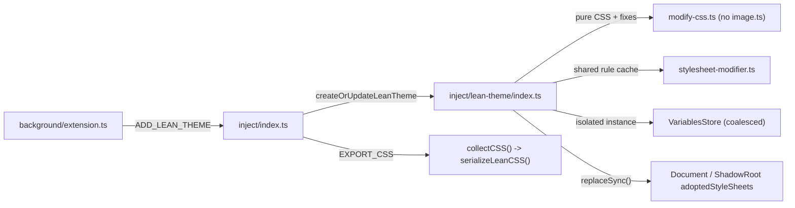

# Architecture & Technical Design

## 1. Overview & Invariants

`leanDynamicTheme` is added as a 5th `ThemeEngine` (`ThemeEngine.leanDynamicTheme`) wired into `src/inject/lean-theme/`. It shares pure CSS/color transform logic with `dynamic-theme/` while replacing DOM `<style class="nyx--sync">` nodes, `image.ts` `<canvas>` analysis, synchronous `treeObserver` / `VariablesStore` runs, and per-sheet rule caches.

**Invariants:**
- `src/inject/dynamic-theme/` runtime behavior for `ThemeEngine.dynamicTheme` is unchanged.
- `src/inject/lean-theme/` never imports `src/inject/dynamic-theme/image.ts`.
- Zero `.nyx--sync` `<style>` DOM elements are created when `leanDynamicTheme` is active.
- `VariablesStore` state in `lean-theme` is isolated from `dynamic-theme`'s module singleton.

## 2. Domain Models, State & Interface Contracts

- **`ThemeEngine` (`src/generators/theme-engines.ts`)**: add `leanDynamicTheme = 'leanDynamicTheme'`.
- **Messaging (`src/utils/message.ts`, `src/background/extension.ts`, `src/inject/index.ts`)**: add `MessageTypeBGtoCS.ADD_LEAN_THEME` (or dispatch `leanDynamicTheme` to `createOrUpdateLeanTheme(theme, fixes, isIFrame)` + `removeLeanTheme()`).
- **Decoupled CSS declaration hook (`src/inject/dynamic-theme/modify-css.ts`)**: extract/accept optional `imageURLModifier` parameter in `getModifiableCSSDeclaration` / `getBgImageModifier`; `dynamic-theme` passes `image.ts` handlers, `lean-theme` passes `null` (preserving `url(...)` / `INVERT` fixes).
- **Shared rule cache (`src/inject/dynamic-theme/stylesheet-modifier.ts`)**: `createStyleSheetModifier(sharedCache?)` accepts an optional bounded `Map<string, ModifiableCSSRule>` + `cssTextIds` shared across `lean-theme` stylesheet instances.
- **AdoptedStyleSheets emitter (`src/inject/lean-theme/adopted-emitter.ts`)**: wraps `new (pageWindow.CSSStyleSheet)()` (via `wrappedJSObject` on Firefox), updates via `sheet.replaceSync(cssText)`, attaches to `Document.adoptedStyleSheets` and open `ShadowRoot.adoptedStyleSheets`, and exposes `serializeLeanCSS()` for `collectCSS()`.

## 3. Architecture Diagram & Data Flow

## 4. Boundary Rules & Budgets

- **Pure Core vs. I/O Shell**: Pure CSS rule parsing, color transforms (`modify-colors.ts`), and `dynamic-theme-fixes.config` resolution have no DOM/network I/O. `src/inject/lean-theme/` owns DOM observers (`MutationObserver` + microtask/rAF coalescing), `adoptedStyleSheets` attachment, and `bgFetch` / `sessionStorage` CSS cache calls.
- **Concurrency, Latency & Resource Budgets**:
  - `0` `.nyx--sync` `<style>` DOM elements and `0` `<canvas>` allocations (`NFR-LEAN-1`).
  - `VariablesStore.matchVariablesAndDependents()` coalesced to at most once per microtask/animation frame during DOM mutation bursts.
  - Shared `ModifiableCSSRule` cache bounded (LRU/cap) to prevent unbounded memory growth across SPA navigations.

## 5. Testing Strategy

1. **BDD Scenarios**: Verify every `REQ-LEAN-*` and `NFR-LEAN-1` scenario via `npm run test:inject` and `npm run test:browser` (headless Chrome MV3).
2. **Unit Tests (>= 95% coverage)**: Unit tests for `ThemeEngine.leanDynamicTheme` validation/dispatch, decoupled `modify-css.ts` (no `image.ts`), shared rule cache hits across simulated SPA remounts, coalesced `VariablesStore` batching, `replaceSync()` `adoptedStyleSheets` emitter, and `collectCSS()`.
3. **Mutation Testing (>= 95% kill)**: Verify pure rule-cache and `modify-css` hook logic against edge-case CSS inputs (`@media`, `@layer`, `--nyx-*`, `${...}`).

## Review Gate
- [x] **Gate 2 Approval**: Architecture & design reviewed and approved by human before task breakdown.
