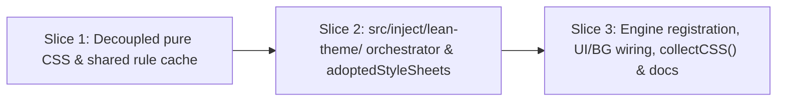

# Tasks

## 1. Dependency DAG

## 2. Streams & Worktrees

| Stream | Worktree Path | Branch | Prerequisite |
| :--- | :--- | :--- | :--- |
| `main-lean-theme` | `.worktrees/add-lean-dynamic-theme` | `feat/lean-dynamic-theme` | Gate 3 Approval |

## 3. Slice 1: Decoupled Pure CSS Helpers & Shared Rule Cache (`REQ-LEAN-3`, `REQ-LEAN-4`, `NFR-LEAN-1`)

- [ ] 3.0 Contract scaffolding: add optional `imageURLModifier` hook signature in `src/inject/dynamic-theme/modify-css.ts` and optional shared rule cache option in `src/inject/dynamic-theme/stylesheet-modifier.ts` without changing `dynamicTheme` defaults (verify: `npm run lint`)
- [ ] 3.1 Red unit tests: verify `getModifiableCSSDeclaration` skips `image.ts` when `imageURLModifier` is `null` and `createStyleSheetModifier(sharedCache)` hits across instances (verify: `npm test` fails as expected before impl)
- [ ] 3.2 Green implementation: implement `imageURLModifier` decoupling in `modify-css.ts` and shared bounded rule cache in `stylesheet-modifier.ts` (verify: `npm test` passes)
- [ ] 3.3 Coverage >= 95% and mutation >= 95% kill on modified helper paths (verify: coverage & mutation checks pass)

## 4. Slice 2: `src/inject/lean-theme/` Core Orchestrator (`REQ-LEAN-2`, `REQ-LEAN-3`, `REQ-LEAN-4`, `NFR-LEAN-1`)

- [ ] 4.0 Contract scaffolding: define `createOrUpdateLeanTheme`, `removeLeanTheme`, `serializeLeanCSS`, and isolated `VariablesStore` / `adopted-emitter.ts` interfaces in `src/inject/lean-theme/` (verify: zero `image.ts` imports in `src/inject/lean-theme/`, `npm run lint`)
- [ ] 4.1 Red tests: assert 0 `.nyx--sync` `<style>` DOM nodes, `replaceSync()` on `adoptedStyleSheets` (including Firefox `wrappedJSObject` path), coalesced `VariablesStore` updates, `dynamic-theme-fixes.config` `--nyx-*` / `${...}` resolution, and `serializeLeanCSS()` output (verify: `npm run test:inject` fails before impl)
- [ ] 4.2 Green implementation: implement `src/inject/lean-theme/` (`index.ts`, `adopted-emitter.ts`, `style-manager.ts`, `inline-style.ts`) with zero `<canvas>` allocations (verify: `npm test` & `npm run test:inject` pass)
- [ ] 4.3 Coverage >= 95% and mutation >= 95% kill on `src/inject/lean-theme/` pure logic (verify: reports pass)

## 5. Slice 3: Engine Wiring, UI/BG Dispatch, `EXPORT_CSS` & Docs (`REQ-LEAN-1`, `NFR-LEAN-1`)

- [ ] 5.0 Contract scaffolding: add `ThemeEngine.leanDynamicTheme` (`src/generators/theme-engines.ts`), `MessageTypeBGtoCS.ADD_LEAN_THEME` (`src/utils/message.ts`), and validation entry (`src/utils/validation.ts`) (verify: `npm run lint`)
- [ ] 5.1 Red tests: verify `validation.ts`, background dispatch (`src/background/extension.ts`), content script routing (`src/inject/index.ts`), `collectCSS()`, and headless MV3 browser test for `leanDynamicTheme` (verify: `npm test` / `npm run test:browser` fail before wiring)
- [ ] 5.2 Green implementation: wire `src/background/extension.ts`, `src/inject/index.ts`, `src/ui/popup/theme/controls/mode.tsx`, `src/ui/popup/theme/page/index.tsx`, `src/ui/devtools/components/body.tsx`, and document `leanDynamicTheme` in `README.md` + `docs/nyx-blueprint.md` (verify: `npm test`, `npm run test:browser`, `npm run test:inject`, `npm run lint`, `npm run build`, `npm run api` all pass)

## 6. Integration & Rebase Plan

- [ ] 6.1 Human Comprehension Verification: reviewer verifies `src/inject/lean-theme/` and `dynamic-theme/` untouched runtime invariant
- [ ] 6.2 Validate with `openspec validate add-lean-dynamic-theme --strict`, merge worktree, re-run full verification gates, and `openspec archive`

## Review Gate
- [x] **Gate 3 Approval**: Tasks breakdown approved by human before writing test code.
