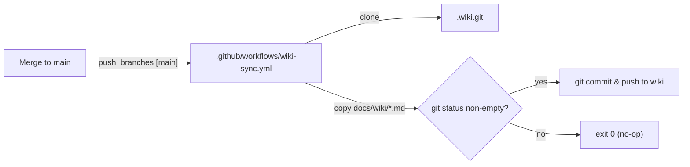

# Architecture & Technical Design

## 1. Overview & Invariants

This change updates `README.md` to use the Nyx icon and document the Nyx Owl color theme, adds `docs/wiki/` source pages, and adds `.github/workflows/wiki-sync.yml` to push wiki updates on `main` merges.

**Invariants:**
- Extension runtime behavior (`src/`) and `tagged-release.yml` remain untouched.
- `.github/workflows/wiki-sync.yml` never creates empty commits when `docs/wiki/` matches the remote wiki.

## 2. Domain Models, State & Interface Contracts

- **`README.md`**: Replace `darkreader-mascot.svg` with local Nyx icon asset (`src/icons/...`), update project description/links to Nyx, and add a Nyx Owl color theme section (`#181a1b` background, `#e8e6e3` text, theme engines summary).
- **`docs/wiki/`**: Markdown pages (`Home.md`, `Theme-Engines.md` or equivalent) synced 1:1 to `<repo>.wiki.git` root.
- **`.github/workflows/wiki-sync.yml`**:
  - Trigger: `on: push: branches: [main]` (plus `workflow_dispatch`).
  - Permissions: `contents: write`.
  - Steps: checkout repo (`actions/checkout`), clone `https://x-access-token:${{ secrets.GITHUB_TOKEN }}@github.com/${{ github.repository }}.wiki.git`, sync `docs/wiki/*.md`, check `git status --porcelain`, and commit + push only if non-empty.

## 3. Architecture Diagram & Data Flow

## 4. Boundary Rules & Budgets

- **Pure Core vs. I/O Shell**: Documentation files (`README.md`, `docs/wiki/*.md`) are static markdown; CI git clone/push side effects live strictly in `.github/workflows/wiki-sync.yml`.
- **Concurrency, Latency & Resource Budgets**: Workflow uses `concurrency: group: wiki-sync` (`cancel-in-progress: false`) so sequential merges to `main` never race on wiki git pushes.

## 5. Testing Strategy

1. **BDD Scenarios**: Verify `REQ-WIKI-1` (`README.md` asset & theme check), `REQ-WIKI-2` (`docs/wiki/` presence & links), and `REQ-WIKI-3` (workflow YAML syntax & `git status --porcelain` guard).
2. **Unit / Validation Checks**: YAML parse check on `.github/workflows/wiki-sync.yml`, verify referenced icon path in `README.md` exists on disk, and run `npm test`, `npm run lint`, `npm run build` to ensure no repo regressions.

## Review Gate
- [x] **Gate 2 Approval**: Architecture & design reviewed and approved by human before task breakdown.
