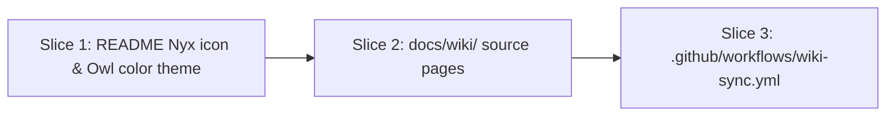

# Tasks

## 1. Dependency DAG

## 2. Streams & Worktrees

| Stream | Worktree Path | Branch | Prerequisite |
| :--- | :--- | :--- | :--- |
| `main-wiki-sync` | `.worktrees/add-wiki-sync-ci` | `docs/wiki-sync-ci` | Gate 3 Approval |

## 3. Slice 1: `README.md` Icon & Nyx Owl Color Theme (`REQ-WIKI-1`)

- [x] 3.1 Verify Nyx icon asset path in `src/icons/` and update `README.md` to replace `darkreader-mascot.svg`, update project links/copy to Nyx, and document the Nyx Owl color theme (`#181a1b` / `#e8e6e3`) (verify: referenced icon path exists on disk and `rg "darkreader-mascot" README.md` returns 0 matches) — verified `src/icons/nyx_128.png` exists, `rg "darkreader-mascot"` 0 matches

## 4. Slice 2: `docs/wiki/` Source Pages (`REQ-WIKI-2`)

- [x] 4.1 Create `docs/wiki/Home.md` and `docs/wiki/Theme-Engines.md` (aligned with `docs/nyx-blueprint.md` and Nyx Owl theme) with valid relative links (verify: files exist and relative links resolve) — created `docs/wiki/Home.md` and `docs/wiki/Theme-Engines.md`

## 5. Slice 3: CI/CD Wiki Sync Workflow (`REQ-WIKI-3`)

- [x] 5.1 Add `.github/workflows/wiki-sync.yml` triggering on `push: branches: [main]` (+ `workflow_dispatch`) with `permissions: contents: write`, `concurrency: group: wiki-sync`, cloning `<repo>.wiki.git`, copying `docs/wiki/*.md`, and committing/pushing only when `git status --porcelain` is non-empty (verify: YAML syntax valid and no-op guard present) — `yaml.safe_load` passed
- [x] 5.2 Run repo verification gates (`npm test`, `npm run lint`, `npm run build`) to confirm zero regressions (verify: all pass) — `npm test` (26/26, 159/159) + `npm run lint` (0 errors) passed

## 6. Integration & Rebase Plan

- [ ] 6.1 Human Comprehension Verification: confirm `wiki-sync.yml` permissions/trigger and `README.md` icon rendering
- [ ] 6.2 Validate with `openspec validate add-wiki-sync-ci --strict`, merge to `main`, verify wiki sync run on GitHub Actions, and `openspec archive`

## Review Gate
- [x] **Gate 3 Approval**: Tasks breakdown approved by human before writing test code.
