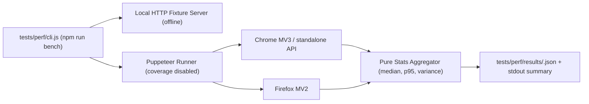

# Architecture & Technical Design

## 1. Overview & Invariants
`engine-measurement` adds a standalone, opt-in Puppeteer benchmark suite under `tests/perf/` (`npm run bench`, `make bench`) that measures Nyx's page-injection, dynamic-theming, and standalone API (`darkreader.js`) performance against local deterministic fixtures.

Key invariants:
- **Zero production coupling (`NFR-BENCH-1`)**: No edits to `src/` runtime behavior; `tests/perf/` consumes built extension bundles (`build/debug/` or `build/release/`) and `darkreader.js` as black-box targets.
- **Zero coverage distortion (`REQ-BENCH-1`)**: Unlike `tests/browser/environment.js`, Puppeteer JS coverage (`coverage.startJSCoverage`) is never started during benchmark runs.
- **Deterministic offline corpus (`REQ-BENCH-2`)**: All fixtures (HTML, CSS, JS, images) are served from the local HTTP server (`tests/browser/server.js` or dedicated static handler) with zero external network calls.
- **Explicit browser capability reporting (`REQ-BENCH-3`)**: Chromium and Firefox results are stored in separate series; unsupported metrics on Firefox (e.g., Chromium CDP trace events) are recorded as `{ value: null, reason: string }`, never `0`.
- **Uninstrumented default (`REQ-BENCH-5`)**: Internal image-stage timings run only when `--diagnostic` is passed.

## 2. Domain Models, State & Interface Contracts

```typescript
interface BenchmarkConfig {
    browsers: Array<'chrome-mv3' | 'firefox'>;
    engines: Array<'none' | 'disabled' | 'cssFilter' | 'svgFilter' | 'dynamicTheme' | 'staticTheme' | 'standalone-api'>;
    fixtures: string[]; // article, gallery, dashboard, spa-churn, shadow-dom, formula, native-dark
    warmups: number;    // default: 5
    runs: number;       // default: 20 (or 3 in --smoke)
    diagnostic: boolean; // default: false
    outputDir: string;  // default: tests/perf/results/ (gitignored)
}

interface MetricValue {
    value: number | null;
    reason?: string;
}

interface BenchmarkSeries {
    browser: 'chrome-mv3' | 'firefox';
    engine: string;
    fixture: string;
    cacheMode: 'cold' | 'warm';
    warmupCount: number;
    sampleCount: number;
    samplesMs: number[];
    failures: number;
    medianMs: number | null;
    p95Ms: number | null;
    longTasksCount: MetricValue;
    observedBrightFrames: MetricValue;
}
```

## 3. Architecture Diagram & Data Flow



## 4. Boundary Rules & Budgets
- **Pure Core vs. I/O Shell**:
  - **Pure Core (`tests/perf/stats.js`)**: Pure percentile (`median`, `p95`), variance, outlier/failure counting, and markdown/JSON formatting functions with zero filesystem, network, or Puppeteer imports.
  - **I/O Shell (`tests/perf/cli.js`, `tests/perf/runner.js`, `tests/perf/fixtures/`)**: Reuses `tests/browser/paths.js` and `tests/browser/server.js`, manages Puppeteer browser/profile lifecycles (fresh `userDataDir` for `cold`, reused page/context for `warm`), and writes results to gitignored `tests/perf/results/`.
- **Concurrency, Latency & Resource Budgets**:
  - Benchmark cases run sequentially (`--runInBand` semantics) so CPU/memory contention never skews timings.
  - Smoke mode (`--smoke`, e.g., 1 warmup + 3 runs on a subset) completes quickly for manual CI/local sanity checks; full baseline runs 5 warmups + 20 measured runs per case.

## 5. Testing Strategy
1. **BDD Scenarios**: Verify CLI flag parsing (`--smoke`, `--diagnostic`, `--browser`, `--engine`), offline fixture serving, cold vs. warm separation, and `null` + reason handling for unsupported Firefox metrics.
2. **Unit Tests (>= 95% coverage)**: Unit-test `tests/perf/stats.js` (median, p95, empty/failed sample handling, environment metadata formatting) under `npm test` (`tests/unit/`).
3. **Mutation Testing (>= 95% kill)**: Verify `stats.js` boundary conditions (even/odd sample counts, single-sample arrays, `null` metric preservation, failure exclusion) via targeted assertion tests.

## Review Gate
- [ ] **Gate 2 Approval**: Architecture & design reviewed and approved by human before task breakdown.
