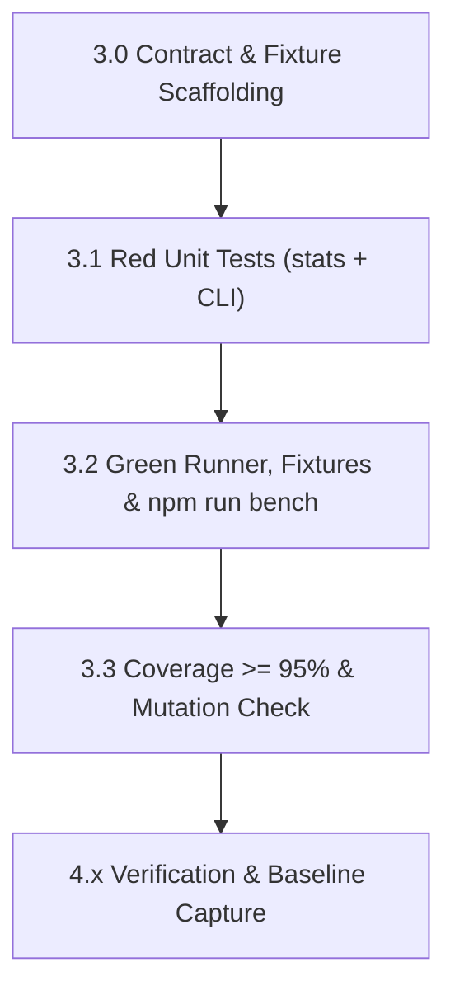

# Tasks

## 1. Dependency DAG

## 2. Streams & Worktrees
| Stream | Worktree Path | Branch | Prerequisite |
| :--- | :--- | :--- | :--- |
| `perf-bench` | `.worktrees/engine-measurement-baseline-perf-bench` | `feat/engine-measurement-baseline` | Gate 3 Approval |

## 3. Slice 1: Offline Benchmark Runner & Baseline

- [ ] 3.0 Contract scaffolding: create `tests/perf/` directory structure (`cli.js`, `runner.js`, `stats.js`, `fixtures/`), add `tests/perf/results/` to `.gitignore`, and add `bench` scripts to `package.json` and `Makefile` (verify: `npm run lint` passes on empty/stubbed files).
- [ ] 3.1 Red unit tests fail for the expected reason: add `tests/unit/perf/stats.tests.ts` covering `median`, `p95`, variance, empty/failed sample handling, `null` metric preservation, and cold/warm metadata formatting (verify: `npm test` fails on unimplemented `stats.js` functions).
- [ ] 3.2 Green implementation: implement `tests/perf/stats.js`, deterministic local fixtures (`article`, `gallery`, `dashboard`, `spa-churn`, `shadow-dom`, `formula`, `native-dark`), `tests/perf/runner.js` (reusing `tests/browser/paths.js` and `tests/browser/server.js` with JS coverage disabled, supporting Chrome MV3, Firefox, and standalone `darkreader.js`, plus `--smoke` and `--diagnostic`), and `tests/perf/cli.js` (verify: `npm test` passes and `npm run bench -- --smoke` emits JSON + summary table).
- [ ] 3.3 Coverage >= 95% and mutation >= 95% kill on `tests/perf/stats.js` (verify: `npm run test:coverage` and boundary mutation checks pass).

## 4. Integration & Baseline Capture

- [ ] 4.1 Full regression gate: run `npm test`, `npm run test:browser`, `npm run test:inject`, `npm run lint`, `npm run build`, and `npm run api` (verify: all pass with zero `src/` production behavior changes).
- [ ] 4.2 Capture initial uninstrumented baseline via `npm run bench` (5 warmups + 20 runs, cold + warm) and record baseline summary for `inject-perf-opt` (verify: raw JSON saved in `tests/perf/results/`).
- [ ] 4.3 Human Comprehension Verification & `openspec archive` readiness check.

## Review Gate
- [ ] **Gate 3 Approval**: Tasks breakdown approved by human before writing test code.
