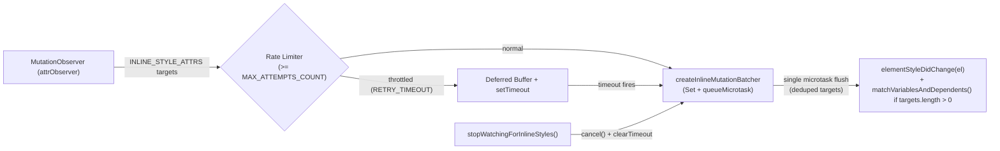

# Architecture & Technical Design

## 1. Overview & Invariants
This change replaces `throttle(handleAttributeMutations)` in `src/inject/dynamic-theme/inline-style.ts` with a deterministic microtask mutation batcher (`createInlineMutationBatcher`) and gates `variablesStore.matchVariablesAndDependents()` on actual inline-style or shadow-host work.

Key invariants:
1. **No dropped targets**: Every `MutationRecord` with `attributeName` in `INLINE_STYLE_ATTRS` delivered before a flush is retained in a `Set<HTMLElement>` (preserving insertion order, deduplicating repeated mutations on the same element).
2. **Single microtask per burst**: At most one `queueMicrotask` flush is scheduled at any time per watcher instance.
3. **Work-gated variable matching**: `variablesStore.matchVariablesAndDependents()` runs at most once per flush and `0` times when no `INLINE_STYLE_ATTRS` or new inline-style/shadow-host elements were processed.
4. **Teardown finality**: Calling `cancel()` (from `stopWatchingForInlineStyles()`) marks the batcher cancelled, clears queued targets, and clears any active `RETRY_TIMEOUT` timer so no stale callbacks fire.

## 2. Domain Models, State & Interface Contracts

A pure, DOM-agnostic batcher factory (in `src/inject/dynamic-theme/inline-mutation-batcher.ts` or exported from a pure helper) encapsulates queuing, deduplication, and cancellation:

```ts
export interface InlineMutationBatcher<T> {
    enqueue(items: readonly T[]): void;
    flushNow(): void;
    cancel(): void;
    readonly pendingCount: number;
}

export interface BatcherOptions<T> {
    scheduleMicrotask: (fn: () => void) => void;
    onFlush: (targets: T[]) => void;
}

export function createInlineMutationBatcher<T>(options: BatcherOptions<T>): InlineMutationBatcher<T>;
```

State transitions:
- `IDLE` (`scheduled = false`, `cancelled = false`, `pending = Set<T>` empty)
- `enqueue(items)` with non-empty `items` when `!cancelled`: adds to `pending`; if `!scheduled`, sets `scheduled = true` and calls `scheduleMicrotask(runFlush)`.
- `runFlush()`: if `cancelled`, resets `scheduled = false` and returns; otherwise snapshots `Array.from(pending)`, clears `pending`, sets `scheduled = false`, and invokes `onFlush(targets)`.
- `cancel()`: sets `cancelled = true`, `scheduled = false`, clears `pending`. Subsequent `enqueue` / `flushNow` calls are no-ops.

In `src/inject/dynamic-theme/inline-style.ts`:
- `attrObserver` filters `MutationRecord`s to `INLINE_STYLE_ATTRS` targets before calling `batcher.enqueue(targets)` (or during `RETRY_TIMEOUT` deferral, buffers targets into `batcher` and flushes when the timer expires).
- `discoverNodes(node)` returns `boolean` (`didDiscover`) indicating whether at least one new `HTMLElement` or `ShadowRoot` was discovered; `treeObserver.onMinorMutations` calls `variablesStore.matchVariablesAndDependents()` only if `didDiscover` is `true`.
- A per-watcher cleanup callback registered in `attrObservers` / cleanup list cancels the batcher and clears `timeoutId` on `stopWatchingForInlineStyles()`.

## 3. Architecture Diagram & Data Flow



## 4. Boundary Rules & Budgets
- **Pure Core vs. I/O Shell**:
  - **Pure Core** (`src/inject/dynamic-theme/inline-mutation-batcher.ts`): Zero DOM, `window`, `MutationObserver`, or `variablesStore` coupling; accepts `scheduleMicrotask` and `onFlush` via dependency injection.
  - **I/O Shell** (`src/inject/dynamic-theme/inline-style.ts`): Owns `MutationObserver`, `setTimeout`/`clearTimeout`, `queueMicrotask` binding, `discoverNodes`, and `variablesStore.matchVariablesAndDependents()`.
- **Concurrency, Latency & Resource Budgets**:
  - Matches `NFR-PERF-2`: deduplicating and flushing 1,000 targets in the pure batcher completes in $\le 5\text{ ms}$; at most 1 `queueMicrotask` scheduled per microtask turn; `Set<T>` is cleared on every flush and on `cancel()` to prevent retaining detached DOM references.

## 5. Testing Strategy
1. **BDD Scenarios**: Map `REQ-PERF-3`, `REQ-PERF-4`, and `NFR-PERF-2` scenarios directly to unit tests (`tests/unit/inject/inline-mutation-batcher.tests.ts`) and inject DOM tests (`tests/inject/dynamic/inline-override.tests.ts`).
2. **Unit Tests (>= 95% coverage)**:
   - Test `createInlineMutationBatcher` with deterministic microtask/manual scheduler stubs: multi-enqueue coalescing, target deduplication order, empty enqueue no-op, `flushNow()`, `cancel()` before microtask runs, `enqueue()` after `cancel()`, and 1,000-item burst timing ($\le 5\text{ ms}$).
   - Run `npm test`, `npm run test:inject`, `npm run test:browser`, `npm run lint`, `npm run build`, and `npm run api`.
3. **Mutation Testing (>= 95% kill)**:
   - Run mutation testing on `src/inject/dynamic-theme/inline-mutation-batcher.ts` and kill all surviving mutants via boundary assertions.

## Review Gate
- [ ] **Gate 2 Approval**: Architecture & design reviewed and approved by human before task breakdown.
