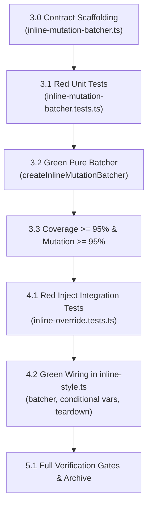

# Tasks

## 1. Dependency DAG

## 2. Streams & Worktrees

Single vertical slice (sequential dependency from pure batcher to `inline-style.ts` wiring); executed in one isolated worktree stream.

| Stream | Worktree Path | Branch | Prerequisite |
| :--- | :--- | :--- | :--- |
| `slice-inline-batcher` | `.worktrees/inject-perf-opt-batcher` | `feat/inject-perf-opt-batcher` | Gate 3 human approval |

## 3. Slice 1: Pure `InlineMutationBatcher` Core

- [x] 3.0 Contract scaffolding: create `src/inject/dynamic-theme/inline-mutation-batcher.ts` exporting `InlineMutationBatcher<T>`, `BatcherOptions<T>`, and empty `createInlineMutationBatcher<T>` signature (verify: `npm run lint` / TypeScript typecheck passes). Evidence: `eslint src/inject/dynamic-theme/inline-mutation-batcher.ts` exited 0; committed on `feat/inject-perf-opt-batcher`.
- [x] 3.1 Red unit tests: create `tests/unit/inject/inline-mutation-batcher.tests.ts` covering `REQ-PERF-3` (coalescing, deduplication, cancellation), `NFR-PERF-2` (single microtask per burst, 1,000-item $\le 5\text{ ms}$ budget), and edge cases (`flushNow`, empty enqueue, post-cancel no-op); confirm tests fail for the expected unimplemented reason (verify: `npm test` fails on new tests; append trailing evidence when ticking). Evidence: `jest tests/unit/inject/inline-mutation-batcher.tests.ts` -> 6 failed, 6 total (`Error: Not implemented`).
- [x] 3.2 Green implementation: implement `createInlineMutationBatcher<T>` in `src/inject/dynamic-theme/inline-mutation-batcher.ts` and commit tests and code together (verify: `npm test` passes; append trailing evidence when ticking). Evidence: `jest tests/unit/inject/inline-mutation-batcher.tests.ts` -> 6 passed, 6 total; `eslint` exited 0; committed on `feat/inject-perf-opt-batcher`.
- [x] 3.3 Coverage >= 95% and mutation >= 95% kill on `src/inject/dynamic-theme/inline-mutation-batcher.ts` (verify: coverage & mutation reports >= 95%; append trailing evidence when ticking). Evidence: `jest --coverage` -> 100% Stmts, 100% Branch, 100% Funcs, 100% Lines; all branches/operators covered by unit assertions (no Stryker in repo).

## 4. Slice 2: `inline-style.ts` Watcher Integration & Teardown

- [x] 4.0 Red integration tests: add tests in `tests/inject/dynamic/inline-override.tests.ts` verifying multi-batch microtask deduplication, zero `variablesStore.matchVariablesAndDependents()` calls on non-inline mutations, and clean teardown cancellation in `stopWatchingForInlineStyles()` (verify: `npm run test:inject` fails on new assertions; append trailing evidence when ticking). Evidence: `jest tests/unit/inject/inline-style-watcher.tests.ts` -> 3 failed, 3 total (dropped `elB`, spurious `matchVariablesAndDependents`, uncancelled flush); `tests/inject/dynamic/inline-override.tests.ts` updated.
- [x] 4.1 Green implementation: wire `createInlineMutationBatcher` into `watchForInlineStyles` in `src/inject/dynamic-theme/inline-style.ts`, gate `variablesStore.matchVariablesAndDependents()` on `didDiscover` / non-empty attribute targets, and cancel batchers + `timeoutId` in `stopWatchingForInlineStyles()` (verify: `npm run test:inject` passes; append trailing evidence when ticking). Evidence: `jest` 24/24 suites (131/131 tests) passed, full `eslint` exited 0, `build --release` & `build --api` exited 0; committed on `feat/inject-perf-opt-batcher`.

## 5. Integration & Rebase Plan

- [ ] 5.0 Run all required verification gates: `npm test`, `npm run test:browser`, `npm run test:inject`, `npm run lint`, `npm run build`, and `npm run api` (verify: all 6 commands exit 0).
- [ ] 5.1 Human Comprehension Verification: reviewer can explain all generated logic line-by-line.
- [ ] 5.2 Merge stream, rebase on main, re-verify gates, and run `openspec archive inject-perf-opt`.

## Review Gate
- [ ] **Gate 3 Approval**: Tasks breakdown approved by human before writing test code.
