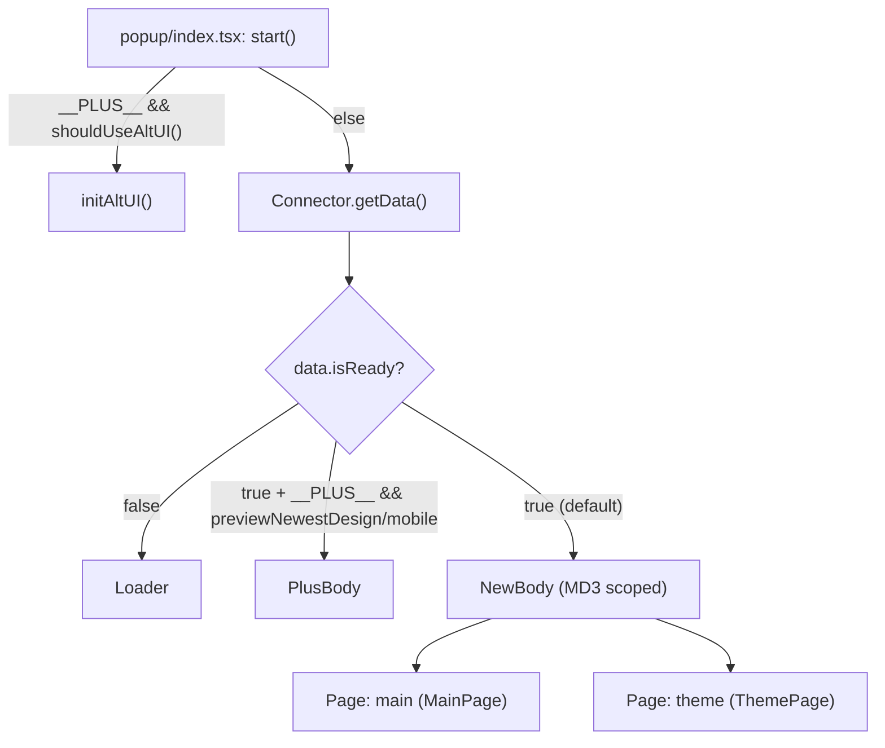

# Architecture & Technical Design

## 1. Overview & Invariants
- Consolidates all non-Plus popup rendering (`src/ui/popup/`) onto `NewBody` (`src/ui/popup/body/index.tsx`), removing Classic UI (`src/ui/popup/components/*`) and `previewNewDesign`.
- **Invariants**:
  - `__PLUS__` (`initAltUI`, `shouldUseAltUI`, `PlusBody`, `previewNewestDesign`) and `src/stubs/` remain intact.
  - `src/ui/theme.less` and shared `src/ui/controls/` global styles remain unchanged so `options/`, `devtools/`, and `stylesheet-editor/` are unaffected; MD3 tokens and overrides live inside `src/ui/popup/`.
  - `Loader` is relocated from `src/ui/popup/components/loader/` to `src/ui/popup/loader/` (or rendered directly by the consolidated popup body) when `!data.isReady`.

## 2. Domain Models, State & Interface Contracts
- **`UserSettings` (`src/definitions.d.ts`, `src/defaults.ts`, `src/utils/validation.ts`)**:
  - Remove `previewNewDesign: boolean` from `UserSettings`, `DEFAULT_SETTINGS`, `validateSettings`, `src/ui/connect/mock.ts`, `tests/unit/utils/validation.tests.ts`, and `tests/inject/utils/url.tests.ts`.
- **Popup Entry & Body (`src/ui/popup/index.tsx`, `src/ui/popup/body/index.tsx`)**:
  - `src/ui/popup/index.tsx` removes `html.preview` toggling and mounts the consolidated popup root (`Loader` when `!data.isReady`, `PlusBody` when `__PLUS__ && (previewNewestDesign || (isMobile && v >= 4009093))`, else `NewBody`).
  - `src/ui/popup/body/index.tsx` narrows `PageId` to `'main' | 'theme'`.
- **DevTools (`src/ui/devtools/components/body.tsx`)**:
  - Remove `previewButtonText`, `toggleDesign`, and `.preview-design-button`.

## 3. Architecture Diagram & Data Flow

## 4. Boundary Rules & Budgets
- **Pure Core vs. I/O Shell**: Settings validation (`src/utils/validation.ts`) and defaults (`src/defaults.ts`) remain pure data/functions; DOM mounting, `chrome.storage.local` reads (`getInstallationData`), and `Connector` messaging stay in `src/ui/popup/index.tsx` and `NewBody`.
- **Concurrency, Latency & Resource Budgets**:
  - `PageViewer` transitions use GPU-composited CSS transforms/opacity (`<= 16ms` per frame).
  - MD3 tokens (`--md-surface-*`, `--md-primary`, `--md-outline`, etc. or Less variables scoped under `src/ui/popup/`) add zero runtime JS overhead.

## 5. Testing Strategy
1. **BDD Scenarios**: Verify `REQ-POPUP-1`..`REQ-POPUP-4` via `tests/browser/e2e/toggle.tests.ts` and `tests/browser/e2e/news.tests.ts` updated for `NewBody` selectors.
2. **Unit Tests (>= 95% coverage)**: Update `tests/unit/utils/validation.tests.ts` (drop `previewNewDesign`, add test confirming unknown legacy `previewNewDesign` key does not fail `validateSettings`) and `tests/inject/utils/url.tests.ts`.
3. **Mutation Testing (>= 95% kill)**: Run mutation/unit checks on modified `validation.ts` / popup routing helpers; verify `npm test`, `npm run lint`, `npm run build`, `npm run api`, `npm run test:browser`, and `npm run test:inject`.

## Review Gate
- [ ] **Gate 2 Approval**: Architecture & design reviewed and approved by human before task breakdown.
