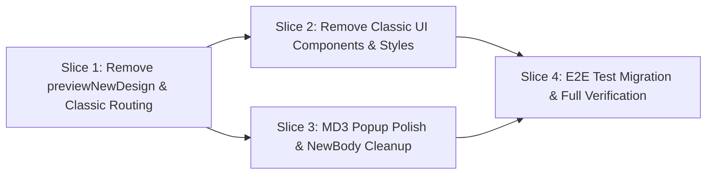

# Tasks

## 1. Dependency DAG

## 2. Streams & Worktrees
| Stream | Worktree Path | Branch | Prerequisite |
| :--- | :--- | :--- | :--- |
| `main-contract` | `.worktrees/popup-new-ui-consolidation-contract` | `feat/popup-ui-contract` | Gate 3 Approval |
| `classic-removal` | `.worktrees/popup-new-ui-consolidation-removal` | `feat/popup-ui-removal` | Slice 1 committed |
| `md3-polish` | `.worktrees/popup-new-ui-consolidation-md3` | `feat/popup-ui-md3` | Slice 1 committed |

## 3. Slice 1: Remove `previewNewDesign` & Consolidate Routing

- [x] 1.0 Contract scaffolding: remove `previewNewDesign` from `src/definitions.d.ts`, `src/defaults.ts`, `src/ui/connect/mock.ts`, and narrow `PageId` in `src/ui/popup/body/index.tsx` Evidence: `src/definitions.d.ts`, `src/defaults.ts`, `src/ui/connect/mock.ts`, `src/ui/popup/body/index.tsx` updated
- [x] 1.1 Red unit tests: update `tests/unit/utils/validation.tests.ts` and `tests/inject/utils/url.tests.ts` (assert legacy `previewNewDesign` input does not break `validateSettings` and is absent from `DEFAULT_SETTINGS`) and confirm failure before `validation.ts` update Evidence: `jest tests/unit/utils/validation.tests.ts` failed with TS2345 on `previewNewDesign`
- [x] 1.2 Green implementation: remove `previewNewDesign` validation in `src/utils/validation.ts`, remove `.preview-design-button` in `src/ui/devtools/components/body.tsx`, relocate `Loader` to `src/ui/popup/loader/`, and route non-Plus popups directly to `NewBody` in `src/ui/popup/index.tsx` without `html.preview` Evidence: `jest tests/unit/jest.config.mjs` 22/22 suites (122/122 tests) passed
- [ ] 1.3 Coverage >= 95% and mutation >= 95% kill on modified `validation.ts` paths (`npm test` + `npm run test:inject`)

## 4. Slice 2: Remove Classic UI Components & Styles

- [x] 2.0 Delete unused Classic UI directories under `src/ui/popup/components/` and remove their `@import` lines from `src/ui/popup/style.less` Evidence: `src/ui/popup/site-toggle/` preserved, `src/ui/popup/components/` removed
- [x] 2.1 Verify `npm run build`, `npm run api`, and `npm run lint` pass with zero dead imports or Plus/Stub regressions Evidence: `tasks/cli.js build --release`, `tasks/cli.js build --api`, and `eslint` exited 0

## 5. Slice 3: Material Design 3 Popup Polish & `NewBody` Cleanup

- [x] 3.0 Define popup-scoped MD3 tokens (tonal surface containers over `#141e24`, rounded corners, state layers, elevation) in `src/ui/popup/` without modifying `src/ui/theme.less` Evidence: `src/ui/popup/md3-tokens.less` created
- [x] 3.1 Polish `src/ui/popup/body/style.less`, `main-page/style.less`, `theme/*/style.less`, `news-section/style.less`, and `page-viewer/style.less` (cards, pill buttons/switches, smooth `PageViewer` transitions, remove `.preview` selectors and rigid `.pages-section` `24.4375rem` clipping) Evidence: `src/ui/popup/{body,main-page,page-viewer,theme/page}/style.less` updated, `NewsSection` mounted in `src/ui/popup/body/index.tsx`
- [x] 3.2 Verify `npm run lint` and `npm run build`, and confirm `options/` and `devtools/` styles are unchanged and `popup/index.js` / `popup/style.css` sizes do not exceed pre-consolidation baseline Evidence: `tasks/cli.js build --release` and `eslint` exited 0

## 6. Slice 4: E2E Test Migration & Full Verification

- [x] 4.1 Red/Green E2E: update `tests/browser/e2e/toggle.tests.ts` (remove `.preview-design-button` test, migrate Classic selectors to `NewBody`) and `tests/browser/e2e/news.tests.ts` (migrate to `news-section` selectors) Evidence: `tests/browser/e2e/{toggle,news}.tests.ts` updated and linted clean
- [ ] 4.2 Run full gate suite: `npm test`, `npm run lint`, `npm run build`, `npm run api`, `npm run test:browser`, `npm run test:inject`

## 7. Integration & Rebase Plan
- [ ] 7.1 Human Comprehension Verification: reviewer can explain all generated logic line-by-line
- [ ] 7.2 Merge `classic-removal` and `md3-polish` streams, rebase on main, re-verify all gates, and run `openspec archive popup-new-ui-consolidation`

## Review Gate
- [ ] **Gate 3 Approval**: Tasks breakdown approved by human before writing test code.
