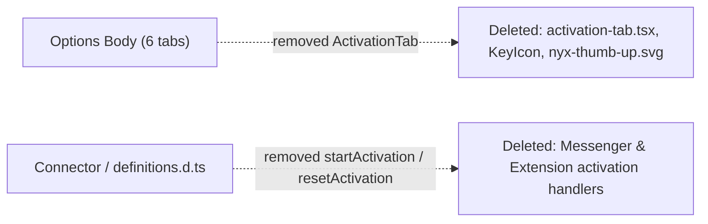

# Architecture & Technical Design

## 1. Overview & Invariants
Remove the legacy license `Activation` tab and all associated dead activation messaging/background methods:
- **Invariant 1**: Settings (`src/ui/options/body/body.tsx`) renders `general`, `site-list`, `automation`, `hotkeys`, `advanced`, and `about` tabs without `activation`.
- **Invariant 2**: `ExtensionActions`, `Connector`, `Messenger`, and `Extension` contain zero `startActivation` / `resetActivation` members.
- **Invariant 3**: Automation schedule fields (`time.activation` / `time.deactivation`) in `AutomationTab` and settings validation remain untouched.

## 2. Domain Models, State & Interface Contracts
Files deleted or updated:
- Delete `src/ui/options/activation/activation-tab.tsx`
- Delete `src/ui/icons/key-icon.tsx` and remove `KeyIcon` from `src/ui/icons/index.tsx`
- Delete `src/ui/assets/images/nyx-thumb-up.svg`
- Edit `src/ui/options/body/body.tsx`: remove `KeyIcon`, `ActivationTab`, and `<TabPanel.Tab id="activation" ...>`
- Edit `src/ui/options/style.less`: remove `.activation__error` and `.activation-tab--checking`
- Edit `src/definitions.d.ts`: remove `startActivation` and `resetActivation` from `ExtensionActions`
- Edit `src/ui/connect/connector.ts`: remove `startActivation` and `resetActivation`
- Edit `src/background/messenger.ts`: remove `startActivation` and `resetActivation` from `MessengerAdapter` and message switch
- Edit `src/background/extension.ts`: remove `startActivation` and `resetActivation` bindings and private methods

## 3. Architecture Diagram & Data Flow

## 4. Boundary Rules & Budgets
- **Pure Core vs. I/O Shell**: Removing dead UI + `writeLocalStorage`/`removeLocalStorage` activation handlers reduces bundle size and eliminates unused message types.
- **Concurrency, Latency & Resource Budgets**: Net bundle size reduction.

## 5. Testing Strategy
1. **BDD Scenarios**: Verify Settings/Extension build cleanly and E2E `test:chrome-mv3` passes.
2. **Unit Tests (`tests/unit/brand/brand.tests.ts`)**: Assert `src/ui/options/body/body.tsx` omits `ActivationTab` and `id="activation"`, `activation-tab.tsx` / `key-icon.tsx` / `nyx-thumb-up.svg` do not exist, and `definitions.d.ts` / `connector.ts` / `messenger.ts` / `extension.ts` omit `startActivation` and `resetActivation`.
3. **Full Verification**: `npm test && npm run lint && npm run build && npm run test:chrome-mv3`.

## Review Gate
- [x] **Gate 2 Approval**: Architecture & design reviewed and approved by human before task breakdown.
