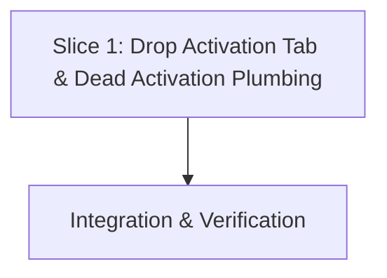

# Tasks

## 1. Dependency DAG

## 2. Streams & Worktrees
| Stream | Worktree Path | Branch | Prerequisite |
| :--- | :--- | :--- | :--- |
| `main` | `.` | `main` | Gate 3 approved |

## 3. Slice 1: Drop Activation Tab & Dead Activation Plumbing

- [x] 3.1 Red unit tests in `tests/unit/brand/brand.tests.ts` asserting `src/ui/options/body/body.tsx` omits `ActivationTab` / `id="activation"`, deleted files (`src/ui/options/activation/activation-tab.tsx`, `src/ui/icons/key-icon.tsx`, `src/ui/assets/images/nyx-thumb-up.svg`) do not exist, and `src/definitions.d.ts`, `src/ui/connect/connector.ts`, `src/background/messenger.ts`, `src/background/extension.ts` omit `startActivation` and `resetActivation` (verify: `npm test` fails on expected assertions) — Evidence: `npx jest --config=tests/unit/jest.config.mjs tests/unit/brand/brand.tests.ts` failed 2/26 (`ActivationTab` in `body.tsx`, `startActivation` in `definitions.d.ts`)
- [x] 3.2 Green implementation: remove `ActivationTab`, `KeyIcon`, `nyx-thumb-up.svg`, `.activation*` CSS, and `startActivation`/`resetActivation` across UI, messaging, and background (verify: `npm test && npm run lint && npm run build`) — Evidence: `npm test` (25/25, 155/155), `npm run lint` (0 errors), `npm run build` (passed)

## 4. Integration & Verification
- [x] 4.1 Run full verification (`npm test`, `npm run lint`, `npm run build`, `npm run test:chrome-mv3`) (verify: all suites pass) — Evidence: `npm test` (25/25, 155/155), `npm run lint` (0 errors), `npm run build` (passed), `npm run test:chrome-mv3` (12/12, 30/30)
- [x] 4.2 Archive `drop-settings-activation` via `openspec archive drop-settings-activation` — Evidence: `openspec archive drop-settings-activation --yes`

## Review Gate
- [x] **Gate 3 Approval**: Tasks breakdown approved by human before writing test code.
