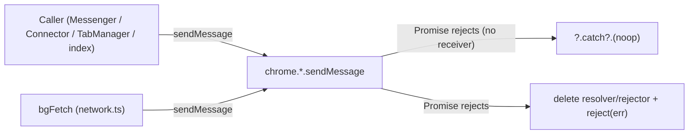

# Architecture & Technical Design

## 1. Overview & Invariants
Guard all unguarded `chrome.runtime.sendMessage` and `chrome.tabs.sendMessage` call sites against disconnected receivers in MV3/MV2/Firefox and disable `match_about_blank` across manifests and `TabManager`.
- **Invariant 1**: Every fire-and-forget `sendMessage` uses `?.catch?.(() => { /* noop */ })` so `undefined` returns (MV2/Jest mocks) never throw `TypeError`.
- **Invariant 2**: `bgFetch` cleans up `resolvers`/`rejectors` maps on `sendMessage` rejection and propagates the rejection to the caller.
- **Invariant 3**: No manifest content script entry or `chrome.tabs.executeScript` call sets `match_about_blank: true` / `matchAboutBlank: true`.

## 2. Domain Models, State & Interface Contracts
Target files:
- `src/background/messenger.ts`: `reportChanges` attaches `?.catch?.(() => { /* noop */ })`
- `src/ui/connect/connector.ts`: private `sendFireAndForget(message: MessageUItoBG)` helper using `chrome.runtime.sendMessage<MessageUItoBG>(message)?.catch?.(() => { /* noop */ })`
- `src/background/tab-manager.ts`: MV2 & Firefox branches in `sendDocumentMessage` attach `?.catch?.(() => { /* noop */ })`; line 460 sets `matchAboutBlank: false`
- `src/background/index.ts`: debug reload `sendMessage` calls attach `?.catch?.(() => { /* noop */ })`
- `src/inject/dynamic-theme/network.ts`: `bgFetch` attaches `?.catch?.((err) => { resolvers.delete(id); rejectors.delete(id); reject(err); })`
- `src/manifest.json`, `src/manifest-chrome-mv3.json`, `src/manifest-firefox.json`: `"match_about_blank": false`

## 3. Architecture Diagram & Data Flow

## 4. Boundary Rules & Budgets
- **Pure Core vs. I/O Shell**: Changes live strictly at the `chrome.*` extension I/O boundary; zero core logic changes.
- **Concurrency, Latency & Resource Budgets**: Zero extra IPC calls or timers (`NFR-MSG-1`).

## 5. Testing Strategy
1. **BDD Scenarios**: `REQ-MSG-1`, `REQ-MSG-2`, `REQ-MSG-3` verified via unit tests and `npm run test:chrome-mv3`.
2. **Unit Tests (`tests/unit/utils/messaging.tests.ts`)**: Mock `chrome.runtime.sendMessage` returning rejected Promise and `undefined`; verify `Messenger.reportChanges`, `Connector` methods, `bgFetch` rejection cleanup, and manifest `match_about_blank: false`.
3. **Full Verification**: `npm test && npm run lint && npm run build && npm run test:chrome-mv3`.

## Review Gate
- [x] **Gate 2 Approval**: Architecture & design reviewed and approved by human before task breakdown.
