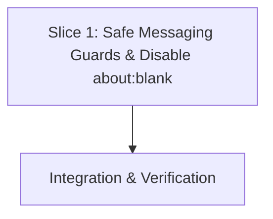

# Tasks

## 1. Dependency DAG

## 2. Streams & Worktrees
| Stream | Worktree Path | Branch | Prerequisite |
| :--- | :--- | :--- | :--- |
| `main` | `.` | `main` | Gate 3 approved |

## 3. Slice 1: Safe Messaging Guards & Disable about:blank

- [x] 3.1 Red unit tests in `tests/unit/utils/messaging.tests.ts` asserting `Messenger.reportChanges`, `Connector`, and `bgFetch` handle rejected `chrome.runtime.sendMessage` Promises without unhandled rejections (and clean up `bgFetch` maps) and manifests set `match_about_blank: false` (verify: `npm test` fails on expected assertions) — Evidence: `npx jest --config=tests/unit/jest.config.mjs tests/unit/utils/messaging.tests.ts` failed 3/4 (`Connector` unhandled rejection, `bgFetch` 5000ms hang + unhandled rejection, `match_about_blank` expected `false` received `true`)
- [x] 3.2 Green implementation: add `?.catch?.(...)` guards in `src/background/messenger.ts`, `src/ui/connect/connector.ts`, `src/background/tab-manager.ts`, `src/background/index.ts`, `src/inject/dynamic-theme/network.ts`, and set `match_about_blank: false` / `matchAboutBlank: false` in `src/manifest*.json` and `src/background/tab-manager.ts` (verify: `npm test && npm run lint && npm run build`) — Evidence: `npm test` (26/26, 159/159), `npm run lint` (0 errors), `npm run build` (passed)

## 4. Integration & Verification
- [x] 4.1 Run full verification (`npm test`, `npm run lint`, `npm run build`, `npm run test:chrome-mv3`) (verify: all suites pass) — Evidence: `npm test` (26/26, 159/159), `npm run lint` (0 errors), `npm run build` (passed), `npm run test:chrome-mv3` (12/12, 30/30)
- [x] 4.2 Archive `fix-mv3-messaging-and-about-blank` via `openspec archive fix-mv3-messaging-and-about-blank` — Evidence: `openspec archive fix-mv3-messaging-and-about-blank --yes`

## Review Gate
- [x] **Gate 3 Approval**: Tasks breakdown approved by human before writing test code.
