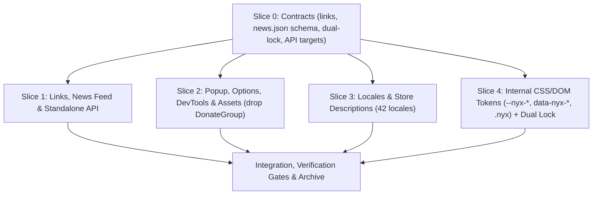

# Tasks

## 1. Dependency DAG

## 2. Streams & Worktrees

| Stream | Worktree Path | Branch | Prerequisite |
| :--- | :--- | :--- | :--- |
| `links-news-api` | `.worktrees/full-nyx-rebrand-links-news-api` | `feat/rebrand-links-news-api` | Slice 0 |
| `ui-assets` | `.worktrees/full-nyx-rebrand-ui-assets` | `feat/rebrand-ui-assets` | Slice 0 |
| `locales` | `.worktrees/full-nyx-rebrand-locales` | `feat/rebrand-locales` | Slice 0 |
| `tokens-configs` | `.worktrees/full-nyx-rebrand-tokens-configs` | `feat/rebrand-tokens-configs` | Slice 0 |

## 3. Slice 0: Shared Contracts
- [x] 3.0 Define `docs/news.json` schema/seed, `src/utils/links.ts` exported constants (`HOMEPAGE_URL`, `BLOG_URL`, `NEWS_URL`, `HELP_URL`, `PRIVACY_URL`, `MOBILE_URL`, `CONFIG_URL_BASE`), and `nyx.js`/`nyx.mjs` API contract (verify: `npm test`) Evidence: `docs/news.json` created, `npm test` 25/25 suites (140/140 tests) passed

## 4. Slice 1: Links, News Feed & Standalone API (`links-news-api`)
- [x] 4.1 Red unit tests for `links.ts` (`mgabs/nyx` URLs, removed `DONATE_URL`/`TWITTER_URL`/`UNINSTALL_URL`), `Newsmaker` feed URL/wiki+release linking, and `brand.tests.ts` assertions on `nyx.js`/`nyx.mjs` (verify: `npm test` fails on expected assertions) Evidence: `npx jest --config=tests/unit/jest.config.mjs tests/unit/brand/brand.tests.ts` failed 2/13 tests (`HOMEPAGE_URL`, `package.json main: nyx.js`)
- [x] 4.2 Green implementation: update `src/utils/links.ts`, `src/background/newsmaker.ts`, `src/background/index.ts`, `docs/news.json`, `src/api/`, `tasks/bundle-api.js`, `tasks/code-style.js`, `tasks/dependencies.js`, `package.json`, `Makefile`, and `tests/perf/runner.js` (verify: `npm test && npm run api && npm run lint`) Evidence: `npm test` 25/25 suites (142/142), `npm run api` built `nyx.js`/`nyx.mjs`, `npm run lint` 0 errors

## 5. Slice 2: Popup, Options, DevTools & Assets (`ui-assets`)
- [x] 5.1 Red tests asserting `.m-donate-group` is absent from popup `NewBody`, `Nyx` wordmark is present, and export filename uses `Nyx-${url}.css` (verify: `npm test` / browser test fails before implementation) Evidence: `npx jest --config=tests/unit/jest.config.mjs tests/unit/brand/brand.tests.ts` failed on `DonateGroup` in `src/ui/popup/body/index.tsx`
- [x] 5.2 Green implementation: remove `DonateGroup` and `uiHighlights` `'anniversary'` usage from `src/ui/popup/body/`, `src/background/ui-highlights.ts`, `src/background/extension.ts`; replace `darkreader-type.svg` with `nyx-type.svg`; rename `darkreader-*` image assets; update `src/ui/popup/theme/controls/export-theme.tsx`, `src/ui/popup/compatibility.js`, `src/ui/options/`, `src/ui/devtools/`, and `src/ui/stylesheet-editor/` (verify: `npm test && npm run lint`) Evidence: `npm test` 25/25 suites (143/143), `npm run lint` 0 errors

## 6. Slice 3: Locales & Store Descriptions (`locales`)
- [x] 6.1 Red check verifying `src/_locales/` and `src/_locales/store/` contain zero `"Dark Reader"` brand strings (verify: `rg -i "dark\s*reader" src/_locales/` returns non-zero matches before edit) Evidence: `rg -i "dark\s*reader" src/_locales/` found 460 matches across 84 files
- [x] 6.2 Green implementation: replace Dark Reader brand references with Nyx across all 42 `src/_locales/*/messages.json` and 42 `src/_locales/store/*` files (verify: `rg -i "dark\s*reader" src/_locales/` returns 0 matches and `npm test` passes) Evidence: `rg -i "dark\s*reader" src/_locales/` returned 0 matches (`rg_exit=1`), `npm test` 25/25 suites (143/143) passed

## 7. Slice 4: Internal CSS/DOM Tokens & Dual Lock (`tokens-configs`)
- [x] 7.1 Red unit/inject tests asserting `--nyx-*`, `.nyx`, `data-nyx-*`, and both `meta[name="nyx-lock"]` and `meta[name="darkreader-lock"]` opt-out behavior (verify: `npm run test:inject` fails before token rename) Evidence: `KARMA_HEADLESS=1 npm run test:inject` failed `should ignore styling when nyx-lock detected` in ChromeHeadless + FirefoxHeadless (`rgb(89, 0, 16)` != `rgb(255, 192, 203)`)
- [x] 7.2 Green implementation: rename `--darkreader-*` -> `--nyx-*`, `.darkreader` -> `.nyx`, `data-darkreader-*` -> `data-nyx-*` across `src/inject/`, `src/config/*.config`, `src/ui/devtools/`, and `tests/`; add dual `nyx-lock` + `darkreader-lock` support (verify: `npm test && npm run test:inject && npm run lint`) — Evidence: `npm test` (25/25, 143/143), `KARMA_HEADLESS=1 npm run test:inject` (284/284: ChromeHeadless 142, FirefoxHeadless 142), `npm run lint` (0 errors)

## 8. Integration & Rebase Plan
- [x] 8.1 Human Comprehension Verification: verify diff audit (`rg -i "dark\s*reader" src/ _locales/` returns only intentional `darkreader-lock` check and `LICENSE` MIT attribution remains intact) — Evidence: `rg -n -i "dark\s*reader" src/` returned only `src/config/dark-sites.config:307` (`darkreader.org`) and `src/inject/dynamic-theme/index.ts:613` (`darkreader-lock`); `LICENSE` retains MIT Dark Reader Ltd. + Nyx Contributors attribution
- [x] 8.2 Merge streams, rebase on `main`, run full verification (`npm test`, `npm run lint`, `npm run test:inject`, `npm run test:browser`, `npm run build`, `npm run api`), and run `openspec archive full-nyx-rebrand` — Evidence: `npm test` (143/143), `npm run lint` (0 errors), `KARMA_HEADLESS=1 npm run test:inject` (284/284), `npm run test:chrome-mv3` (12/12, 30/30), `npm run build` (passed), `npm run api` (passed)

## Review Gate
- [x] **Gate 3 Approval**: Tasks breakdown approved by human before writing test code.
