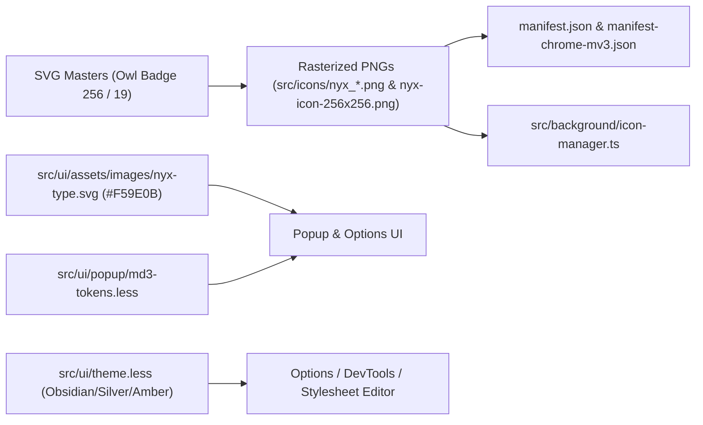

# Architecture & Technical Design

## 1. Overview & Invariants
This change replaces Dark Reader's remaining visual skin with Nyx's **Owl Badge** icons and **Obsidian + Silver + Amber** UI palette across all extension surfaces:
- **Invariant 1**: Zero `dr_*.png` icon files or references remain in `src/icons/`, `src/manifest.json`, `src/manifest-chrome-mv3.json`, or `src/background/icon-manager.ts`.
- **Invariant 2**: Every icon PNG has exact matching pixel dimensions (`16x16`, `19x19`, `38x38`, `48x48`, `128x128`, `256x256`) and transparent outer corners outside the circular badge.
- **Invariant 3**: UI palette tokens in `src/ui/theme.less`, `src/ui/popup/md3-tokens.less`, `src/ui/popup/compatibility.js`, and `src/ui/assets/images/nyx-type.svg` share a single cohesive Obsidian (`#111114`), Silver (`#c4c4cc`), and Amber (`#f59e0b`) color system.

## 2. Domain Models, State & Interface Contracts

### 2.1 Color Token Mapping
| File | Token / Rule | Old Value | New Value (Obsidian + Silver + Amber) |
| :--- | :--- | :--- | :--- |
| `src/ui/theme.less` | `@color-back`, `@color-control-back`, `@color-input-back` | `#141e24` | `#111114` |
| `src/ui/theme.less` | `@color-control-hover`, `@color-input-hover`, `@color-input-active` | `#193945` | `#1c1c22` |
| `src/ui/theme.less` | `@color-control-active` | `#316e7d` | `#92580a` |
| `src/ui/theme.less` | `@color-fore`, `@color-input-fore` | `#53a1b3` | `#c4c4cc` |
| `src/ui/theme.less` | `@color-control-fore`, `@color-input-fore-active`, `@color-selection-fore` | `#ffffff` | `#fafafa` |
| `src/ui/theme.less` | `@color-control-fore-inactive`, `@color-input-fore-placeholder` | `#316e7d` | `#686873` |
| `src/ui/theme.less` | `@color-border` | `#316e7d` | `#2c2c34` |
| `src/ui/theme.less` | `@color-heading`, `@color-selection-back` | `#e96c4c` | `#f59e0b` |
| `src/ui/theme.less` | `@color-error` | `#db4245` | `#ef4444` |
| `src/ui/popup/md3-tokens.less` | `@md-surface` | `#141e24` | `#111114` |
| `src/ui/popup/md3-tokens.less` | `@md-surface-container-low` / `container` / `high` / `highest` | `#19252c` .. `#2c424e` | `#16161b` / `#1c1c22` / `#24242b` / `#2c2c34` |
| `src/ui/popup/md3-tokens.less` | `@md-primary` / `@md-primary-container` / `@md-on-primary` | `#53a1b3` / `#234c57` / `#0b191f` | `#c4c4cc` / `#2a2114` / `#111114` |
| `src/ui/popup/md3-tokens.less` | `@md-on-surface` / `@md-on-surface-variant` | `#eef5f7` / `#9fc3cc` | `#fafafa` / `#a1a1aa` |
| `src/ui/popup/md3-tokens.less` | `@md-outline` / `@md-outline-variant` | `#316e7d` / `rgba(83,161,179,0.28)` | `#2c2c34` / `rgba(196,196,204,0.22)` |
| `src/ui/popup/md3-tokens.less` | `@md-accent` | `#e96c4c` | `#f59e0b` |
| `src/ui/popup/compatibility.js` | `warning.style.color`, `link.style.color` | `#e96c4c` | `#f59e0b` |
| `src/ui/assets/images/nyx-type.svg` | `<g fill="...">` | `#E96C4C` | `#F59E0B` |

### 2.2 Owl Badge Icon Assets
- **Detail variant (`48`, `128`, `256`)**: Dark obsidian `#111114` circular badge, `#c4c4cc` outer rim, crisp geometric owl head with ear tufts, diamond beak, and `#f59e0b` amber eyes.
  - `src/icons/nyx_48.png` (`48x48`)
  - `src/icons/nyx_128.png` (`128x128`)
  - `src/ui/assets/images/nyx-icon-256x256.png` (`256x256`)
- **Toolbar crisp variant (`16`, `19`, `38`)**: Simplified bold silhouette filling the badge so ear tufts and `#f59e0b` amber eyes remain legible at small sizes:
  - `src/icons/nyx_16.png` (`16x16`)
  - `src/icons/nyx_active_19.png` (`19x19`), `src/icons/nyx_active_38.png` (`38x38`) — dark-toolbar variant (silver rim `#c4c4cc`, bright owl fill)
  - `src/icons/nyx_active_light_19.png` (`19x19`), `src/icons/nyx_active_light_38.png` (`38x38`) — light-toolbar variant (dark rim `#2c2c34`, crisp contrast on light Chrome/Firefox toolbars)

## 3. Architecture Diagram & Data Flow

## 4. Boundary Rules & Budgets
- **Pure Core vs. I/O Shell**: Static CSS/LESS tokens and pre-rendered PNG/SVG assets introduce zero runtime I/O, zero background CPU work, and preserve `NFR-POPUP-1` (`<= 16ms` transition frame budget).
- **Concurrency, Latency & Resource Budgets**: PNG assets stay compact (`< 20KB` total diff impact on bundle zip).

## 5. Testing Strategy
1. **BDD Scenarios**: Verify `REQ-POPUP-3` and `REQ-BRAND-6` via `npm run build` and `npm run test:chrome-mv3`.
2. **Unit Tests (`tests/unit/brand/brand.tests.ts`)**:
   - Assert `src/icons/nyx_{16,48,128}.png`, `nyx_active_{19,38}.png`, `nyx_active_light_{19,38}.png` exist and no `dr_*.png` files remain.
   - Assert PNG IHDR headers match expected pixel widths/heights (`16`, `19`, `38`, `48`, `128`, `256`).
   - Assert `src/manifest.json`, `src/manifest-chrome-mv3.json`, and `src/background/icon-manager.ts` contain zero `dr_` icon paths.
   - Assert `src/ui/theme.less`, `src/ui/popup/md3-tokens.less`, and `src/ui/assets/images/nyx-type.svg` use `#111114` / `#c4c4cc` / `#f59e0b` and no legacy `#141e24` / `#e96c4c` / `#53a1b3`.
3. **Full Verification**: `npm test && npm run lint && npm run build && npm run test:chrome-mv3`.

## Review Gate
- [x] **Gate 2 Approval**: Architecture & design reviewed and approved by human before task breakdown.
