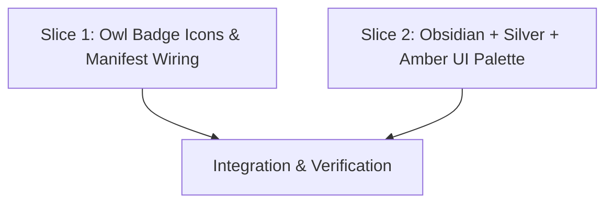

# Tasks

## 1. Dependency DAG

## 2. Streams & Worktrees
| Stream | Worktree Path | Branch | Prerequisite |
| :--- | :--- | :--- | :--- |
| `main` (sequential or 2 streams) | `.` (or `.worktrees/nyx-owl-theme-icons`, `.worktrees/nyx-owl-theme-palette`) | `main` | Gate 3 approved |

## 3. Slice 1: Owl Badge Icons & Manifest Wiring

- [x] 3.1 Red unit tests in `tests/unit/brand/brand.tests.ts` asserting `src/icons/nyx_{16,48,128}.png`, `nyx_active_{19,38}.png`, `nyx_active_light_{19,38}.png` exist with valid PNG IHDR dimensions (`16`, `19`, `38`, `48`, `128`, `256` for `nyx-icon-256x256.png`), zero `dr_*.png` files remain in `src/icons/`, and `src/manifest.json`, `src/manifest-chrome-mv3.json`, `src/background/icon-manager.ts` contain zero `dr_` references (verify: `npm test` fails on expected assertions) — Evidence: `npx jest --config=tests/unit/jest.config.mjs tests/unit/brand/brand.tests.ts` failed 8/23 tests (`ENOENT` on `nyx_*.png`)
- [x] 3.2 Green implementation: generate crisp transparent Owl Badge PNGs (`src/icons/nyx_*.png` and `src/ui/assets/images/nyx-icon-256x256.png`) from SVG masters, remove legacy `src/icons/dr_*.png`, and update `src/manifest.json`, `src/manifest-chrome-mv3.json`, and `src/background/icon-manager.ts` (verify: `npm test && npm run lint && npm run build`) — Evidence: `npm test` (25/25, 152/152), `npm run lint` (0 errors), `npm run build` (passed)

## 4. Slice 2: Obsidian + Silver + Amber UI Palette

- [x] 4.1 Red unit tests in `tests/unit/brand/brand.tests.ts` asserting `src/ui/theme.less`, `src/ui/popup/md3-tokens.less`, `src/ui/popup/compatibility.js`, and `src/ui/assets/images/nyx-type.svg` use `#111114` / `#c4c4cc` / `#f59e0b` tokens and contain zero legacy `#141e24` / `#e96c4c` / `#53a1b3` tokens (verify: `npm test` fails on expected assertions) — Evidence: `npx jest --config=tests/unit/jest.config.mjs tests/unit/brand/brand.tests.ts` failed 1/24 (`Expected substring: "#111114"` in `src/ui/theme.less`)
- [x] 4.2 Green implementation: update `src/ui/theme.less`, `src/ui/popup/md3-tokens.less`, `src/ui/popup/compatibility.js`, and `src/ui/assets/images/nyx-type.svg` to the Obsidian + Silver + Amber palette (verify: `npm test && npm run lint`) — Evidence: `npm test` (25/25, 153/153), `npm run lint` (0 errors)

## 5. Integration & Verification
- [x] 5.1 Run full verification (`npm test`, `npm run lint`, `npm run build`, `npm run test:chrome-mv3`) and visually inspect built icons/UI (verify: all suites pass) — Evidence: `npm test` (25/25, 153/153), `npm run lint` (0 errors), `npm run build` (passed), `npm run test:chrome-mv3` (12/12, 30/30)
- [x] 5.2 Archive `nyx-owl-theme` via `openspec archive nyx-owl-theme` — Evidence: `openspec archive nyx-owl-theme --yes`

## Review Gate
- [x] **Gate 3 Approval**: Tasks breakdown approved by human before writing test code.
