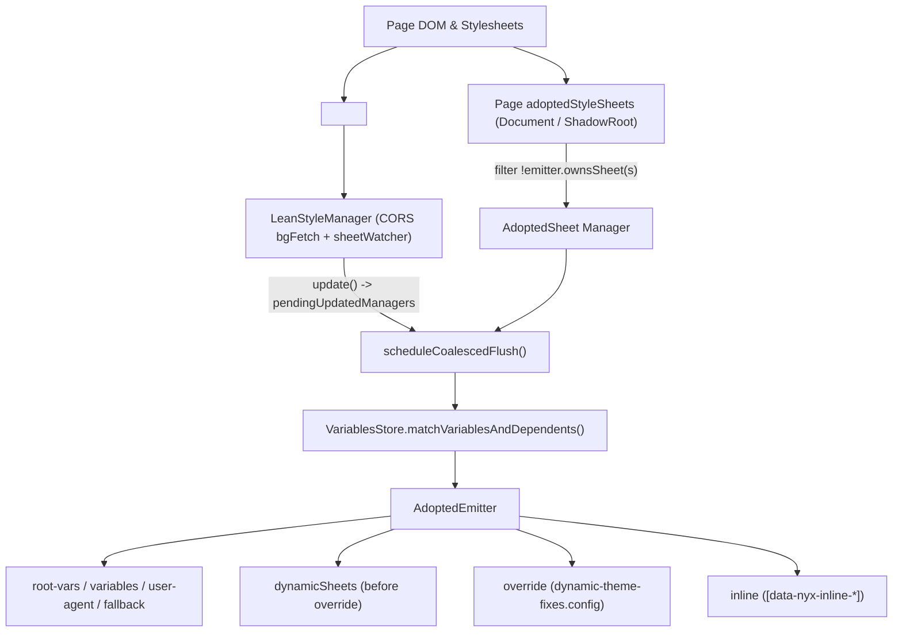

# Architecture & Technical Design

## 1. Overview & Invariants
This design fixes four defects in `src/inject/lean-theme/` so `leanDynamicTheme` matches `dynamicTheme` visual correctness on YouTube and heavy SPAs while preserving `adoptedStyleSheets` emission and zero `<canvas>` image analysis:
- **Invariant 1 (Zero Stale Fallback)**: `loadingCount` is scoped to the active lifecycle and reset to `0` on `removeLeanTheme()`; `cleanFallback()` executes whenever `loadingCount === 0` after DOM ready.
- **Invariant 2 (Reactive Sheet Updates)**: Every `LeanStyleManager` `update()` callback enqueues that manager in `pendingUpdatedManagers`, ensuring `flushCoalescedMutations()` re-matches variables if needed and re-renders its output `CSSStyleSheet`.
- **Invariant 3 (Cascade Order)**: `adoptedStyleSheets` on `document` and `ShadowRoot` always maintain the relative order:
  `[root-vars, variables, user-agent, fallback, text, invert, ...dynamicSheets, override, inline]`.
- **Invariant 4 (No Self-Theming Loop)**: `AdoptedEmitter` exposes `ownsSheet(sheet: CSSStyleSheet): boolean` so page-authored `adoptedStyleSheets` inspection skips all Nyx-owned sheets.

## 2. Domain Models, State & Interface Contracts

### `AdoptedEmitter` (`src/inject/lean-theme/adopted-emitter.ts`)
- Track all emitted sheets in `ownedSheets: WeakSet<CSSStyleSheet>` (or `Set<CSSStyleSheet>` cleared on `destroy()`).
- Extend `AdoptedEmitter` interface:
  - `ownsSheet(sheet: CSSStyleSheet): boolean`
  - `attachPosition`: support `'beginning' | 'middle' | 'ending'` or maintain insertion order where `dynamicSheets` are inserted **before** `override` and `inline` (e.g., `createDynamicSheet(root)` inserts before `rootNamed.get('override')` / `rootNamed.get('inline')` if present).
- For Firefox (`wrappedJSObject`), `attachAdoptedSheet` and `detachAdoptedSheets` preserve the same relative ordering.

### `LeanTheme` Orchestrator (`src/inject/lean-theme/index.ts`)
- Add `const pendingUpdatedManagers = new Set<LeanStyleManager>();`
- Add `const adoptedSheetManagers = new Map<CSSStyleSheet, LeanStyleManager>();` (or weak/cleanup map per `Document | ShadowRoot` for page-authored `adoptedStyleSheets`).
- `createManager(element, root)`:
  - `update` callback becomes:
    ```ts
    update: () => {
        pendingUpdatedManagers.add(manager);
        scheduleCoalescedFlush();
    }
    ```
- `flushCoalescedMutations()`:
  - Process `pendingRemovedStyles`, `pendingAddedStyles`, `pendingShadowHosts`.
  - For each manager in `pendingUpdatedManagers`:
    - Call `manager.details({secondRound: true})`; if rules exist, `leanVariablesStore.addRulesForMatching(detail.rules)` and set `pendingVariablesMatch = true`.
  - Run `matchVariablesAndDependents()` and `updateRootVars()` if `pendingVariablesMatch || pendingRootVars`.
  - Render `newlyAddedManagers` and `pendingUpdatedManagers` (deduplicated, skipping destroyed managers), then clear `pendingUpdatedManagers`.
- `removeLeanTheme()`:
  - Reset `loadingCount = 0;`, clear `pendingUpdatedManagers`, destroy `adoptedSheetManagers`.
- Page-authored `adoptedStyleSheets`:
  - Helper `syncPageAdoptedSheets(root: Document | ShadowRoot)` iterates `getAdoptedSheets(root)`, filters `!activeEmitter.ownsSheet(sheet)`, creates a `LeanStyleManager` (or `StyleSheetModifier` adapter) for each unseen page-authored `CSSStyleSheet`, adds its `cssRules` to `leanVariablesStore`, and renders into a Nyx `dynamicSheet` on `root`.

## 3. Architecture Diagram & Data Flow



## 4. Boundary Rules & Budgets
- **Pure Core vs. I/O Shell**: CSS modification and variable resolution remain in pure `src/inject/dynamic-theme/modify-css.ts`, `stylesheet-modifier.ts`, and `variables.ts`. DOM/CSSOM observation, `AdoptedEmitter`, and `bgFetch` stay in `src/inject/lean-theme/`.
- **Concurrency, Latency & Resource Budgets**:
  - Matches `NFR-LEAN-1`: `imageURLModifier: null` (zero `<canvas>` reads), zero `<style>` DOM injections.
  - Coalesced microtask + `requestAnimationFrame` batching in `flushCoalescedMutations()` prevents redundant variable re-matching across bursty YouTube SPA mutations.

## 5. Testing Strategy
1. **BDD Scenarios**:
   - Verify every scenario in `specs/lean-dynamic-theme/spec.md` (`REQ-LEAN-1` through `REQ-LEAN-4`, `NFR-LEAN-1`).
2. **Unit Tests (`tests/unit/inject/lean-theme.tests.ts`)**:
   - `loadingCount` reset across `removeLeanTheme()` -> `createOrUpdateLeanTheme()`.
   - `update()` callback triggers re-render of existing `LeanStyleManager` in `flushCoalescedMutations()`.
   - `adoptedStyleSheets` ordering places `dynamicSheets` before `override` and `inline`.
   - `emitter.ownsSheet()` prevents re-theming Nyx's own sheets while theming page-authored `adoptedStyleSheets`.
3. **Inject / Live Verification (`tests/inject/dynamic/lean-theme.tests.ts` + Chrome)**:
   - Run `npm test`, `npm run test:inject`, `npm run lint`, `npm run build`, `npm run api`.
   - Re-run headless Chrome inspection on `youtube.com/@YouTube/videos`, `/results`, `/watch` to confirm video thumbnails, channel avatars, and sidebar icons are visible.

## Review Gate
- [x] **Gate 2 Approval**: Architecture & design reviewed and approved by human before task breakdown.
