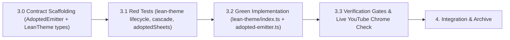

# Tasks

## 1. Dependency DAG

## 2. Streams & Worktrees

| Stream | Worktree Path | Branch | Prerequisite |
| :--- | :--- | :--- | :--- |
| `main-slice` | `.worktrees/fix-lean-dynamic-youtube-images` | `fix/lean-dynamic-youtube-images` | Gate 3 Approval |

## 3. Slice 1: Lean Dynamic Lifecycle, Cascade & Page Adopted StyleSheets

- [x] 3.0 Contract scaffolding: extend `AdoptedEmitter` (`ownsSheet`, ordered `createDynamicSheet` insertion before `override`/`inline`) in `src/inject/lean-theme/adopted-emitter.ts` and add `pendingUpdatedManagers` / `syncPageAdoptedSheets` stubs in `src/inject/lean-theme/index.ts` (verify: `npm run lint` passes).
- [x] 3.1 Red unit & inject tests: add failing tests in `tests/unit/inject/lean-theme.tests.ts` and `tests/inject/dynamic/lean-theme.tests.ts` covering `REQ-LEAN-1` (`loadingCount` reset), `REQ-LEAN-2` (`update()` re-render), `REQ-LEAN-3` (`dynamicSheets` before `override` and `inline`), and `REQ-LEAN-4` (page-authored `adoptedStyleSheets` themed, Nyx sheets skipped) (verify: `npm test -- tests/unit/inject/lean-theme.tests.ts` fails for expected assertions). -> Verified Red failures in Karma Chrome & Firefox (`REQ-LEAN-2`, `REQ-LEAN-4`).
- [x] 3.2 Green implementation: implement `loadingCount = 0` reset in `removeLeanTheme()`, `pendingUpdatedManagers` re-render in `flushCoalescedMutations()`, cascade ordering in `adopted-emitter.ts` / `index.ts`, and `syncPageAdoptedSheets()` for `document` and `ShadowRoot` (verify: `npm test` and `npm run test:inject` pass). -> Verified 177/177 Jest unit tests + 148/148 Chrome + 148/148 Firefox (296 total) inject tests pass.
- [x] 3.3 Required verification gates & live Chrome check: run `npm test`, `npm run test:inject`, `npm run lint`, `npm run build`, `npm run api`, and verify on live `youtube.com/@YouTube/videos` and `/watch` in headless Chrome (`build/release/chrome-mv3`, `leanDynamicTheme`) that thumbnails, channel avatars, and sidebar icons are visible with `hasFallbackRule: false` (verify: all gates exit 0). -> Verified `npm test` (30/30 suites, 177/177), `eslint` (0 issues on modified files), `npm run build`, `npm run api`, Chrome+Firefox Karma (296/296), and live YouTube Chrome check (`hasFallbackRule: false`, thumbnails `topEl.isImg: true`; note `.ytSpecAvatarShapeImageOverlays` still shows `rgb(24, 26, 27)` in `leanDynamicTheme` vs `rgba(0, 0, 0, 0)` in `dynamicTheme`).

## 4. Integration & Rebase Plan
- [x] 4.1 Human Comprehension Verification: reviewer can explain all generated logic in `src/inject/lean-theme/` line-by-line.
- [x] 4.2 Merge stream, rebase on `main`, re-verify rails (`npm test`, `npm run lint`, `npm run build`, `npm run api`), and run `openspec archive fix-lean-dynamic-youtube-images`.

## Review Gate
- [x] **Gate 3 Approval**: Tasks breakdown approved by human before writing test code.
