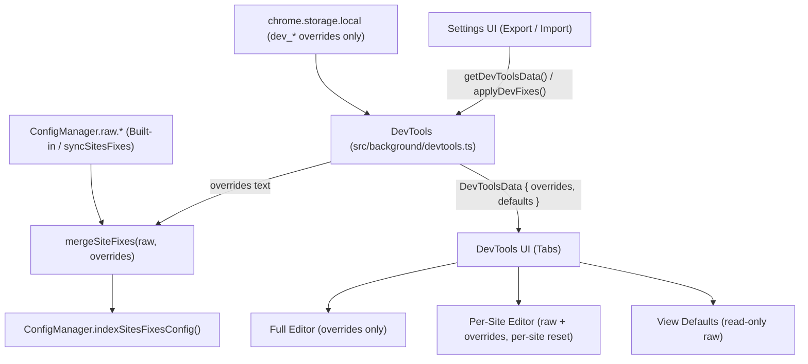

# Architecture & Technical Design

## 1. Overview & Invariants
This design replaces monolithic DevTools config shadowing with a two-layer model (`ConfigManager.raw` + user `overrides`), fixes `detectorHints` startup restoration, isolates per-site DevTools operations, adds a read-only `View Defaults` tab alongside an overrides-only `Full Editor`, and integrates DevTools overrides into `Nyx-Settings.json` Export/Import.

### Key Invariants
1. **Base Layer Immutability**: `ConfigManager.raw.*` is never mutated by DevTools; `syncSitesFixes` remote updates always refresh `raw` without overwriting user overrides.
2. **Override Replacement (No Stacking)**: Merging `raw` + `overrides` replaces any `raw` block whose normalized `url` list matches an override block, so `getSitesFixesFor()` never returns both the built-in and overridden rule for the same URL list.
3. **Overrides-Only Persistence**: `chrome.storage.local` (`dev_detector_hints`, `dev_dynamic_theme_fixes`, `dev_inversion_fixes`, `dev_static_themes`) stores only user overrides. Legacy monolithic blobs detected on load are diffed against `ConfigManager.raw.*` to extract only differing/added blocks.
4. **Backward-Compatible Settings JSON**: `Nyx-Settings.json` adds an optional `devTools` property; legacy `UserSettings`-only JSON files continue to import cleanly.

## 2. Domain Models, State & Interface Contracts

### Pure Merge & Diff Core (`src/generators/utils/overrides.ts`)
```ts
export function normalizeURLKey(urls: string[]): string;

export function mergeSiteFixes<T extends SiteProps>(
    rawText: string,
    overrideText: string,
    parse: (text: string) => T[],
    format: (fixes: T[]) => string,
): string;

export function diffSiteFixes<T extends SiteProps>(
    rawText: string,
    fullText: string,
    parse: (text: string) => T[],
    format: (fixes: T[]) => string,
): string;
```
- `mergeSiteFixes`: parses `rawText` and `overrideText`; excludes `raw` entries whose `normalizeURLKey(fix.url)` appears in `overrides`, then appends `overrides` and formats.
- `diffSiteFixes`: used once when migrating legacy monolithic `dev_*` storage blobs (returns only entries added or differing from `raw`).

### Extended `DevToolsData` (`src/definitions.d.ts`)
```ts
export interface DevToolsData {
    detector: string;   // user overrides only ('' if none)
    dynamic: string;    // user overrides only ('' if none)
    filter: string;     // user overrides only ('' if none)
    static: string;     // user overrides only ('' if none)
    defaults: Record<DevFixType, string>; // read-only formatted ConfigManager.raw.*
}
```

### Settings Export Envelope (`Nyx-Settings.json`)
```ts
export interface ExportedSettings extends UserSettings {
    devTools?: Partial<Record<DevFixType, string>>;
}
```
- `ExportSettings` calls `actions.getDevToolsData()` (or `Connector.getDevToolsData()`) on click, attaches non-empty `devTools` overrides, and downloads `Nyx-Settings.json`.
- `ImportSettings` validates `UserSettings` via `validateSettings()`, validates optional `devTools` via `validateDevToolsOverrides()`, closes `warningDialog` *before* calling `openFile()`, and applies valid overrides via `actions.applyDevFixes` / `actions.resetDevFixes`.

### UI Component Contracts
- `ConfigEditorTabs`: 3 vertical tabs:
  1. `Full Editor` (`ConfigEditor` bound to `props.devtools[props.type]` overrides only)
  2. `Per Site Editor` (`PerSiteConfigEditor` merging `defaults[type]` + `devtools[type]`, tracking `status: 'default' | 'overridden' | 'custom'`)
  3. `View Defaults` (read-only `<textarea readonly>` displaying `props.devtools.defaults[props.type]`)
- `ConfigEditor`: guards `keydown` listener attachment once per DOM node, uses `setRangeText(indent, start, end, 'end')` for Tab indentation, and clears `store.dialogMessage`/`store.dialogAction` on `delete`.
- `ImportSettings` & `ResetSettings`: render `<MessageBox>` as siblings *outside* `<Button>`.

## 3. Architecture Diagram & Data Flow



## 4. Boundary Rules & Budgets
- **Pure Core vs. I/O Shell**:
  - **Pure Core** (`src/generators/utils/overrides.ts`, `src/utils/validation.ts`): pure functions operating on strings and parsed `SiteProps[]` with zero `chrome.*`, DOM, or network calls.
  - **I/O Shell** (`src/background/devtools.ts`, `src/background/config-manager.ts`, `src/ui/devtools/*`, `src/ui/options/advanced/*`): handles `chrome.storage.local`, `Connector` messaging, file I/O, and Malevic DOM rendering.
- **Concurrency, Latency & Resource Budgets**:
  - Matches `NFR-DEVTOOLS-1`: `mergeSiteFixes` runs synchronously in memory with no network I/O; `chrome.storage.local` stores only override blocks (typically < 10 KB vs ~100+ KB monolithic blobs).
  - UI input latency: `PerSiteConfigEditor` search filtering and `ConfigEditor` Tab indentation remain synchronous (< 16 ms frame budget).

## 5. Testing Strategy
1. **BDD Scenarios**:
   - Update/extend `tests/browser/e2e/devtools.tests.ts` to cover Full Editor overrides-only paste + reset, Per-Site Editor isolated reset/delete, and `View Defaults` tab presence.
   - Add browser/settings test coverage for `Nyx-Settings.json` export/import round-trip (with and without `devTools`) and cancelled file picker dialog dismissal.
2. **Unit Tests (>= 95% coverage)**:
   - `tests/unit/generators/overrides.tests.ts`: `mergeSiteFixes`, `diffSiteFixes`, `normalizeURLKey`, empty/multi-block/duplicate-URL edge cases.
   - `tests/unit/background/devtools.tests.ts`: startup restore for all 4 `DevFixType`s (including `detectorHints`), legacy monolithic migration, per-site reset isolation.
   - `tests/unit/utils/validation.tests.ts`: `validateDevToolsOverrides` valid, malformed, and legacy `UserSettings`-only inputs.
3. **Mutation Testing (>= 95% kill)**:
   - Target `src/generators/utils/overrides.ts` and `validateDevToolsOverrides` in `src/utils/validation.ts` via Stryker (`openspec/spec-rails/mutation/stryker.config.json`) during implementation/verification.

## Review Gate
- [x] **Gate 2 Approval**: Architecture & design reviewed and approved by human before task breakdown.
