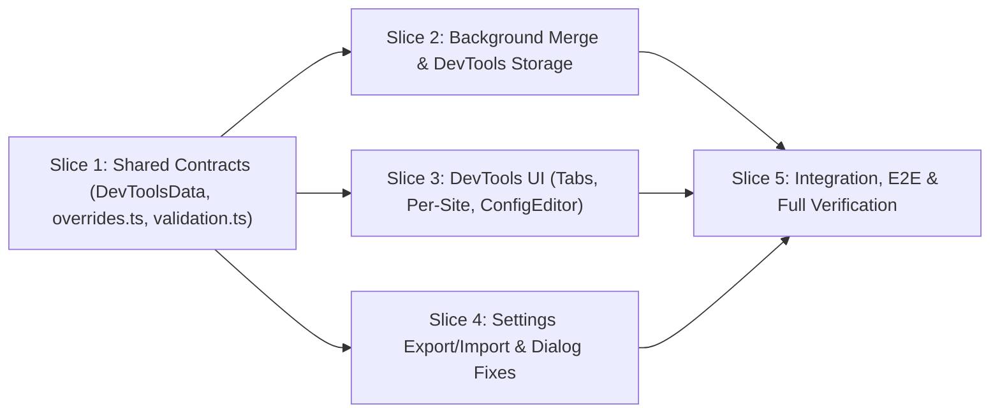

# Tasks

## 1. Dependency DAG

## 2. Streams & Worktrees

| Stream | Worktree Path | Branch | Prerequisite |
| :--- | :--- | :--- | :--- |
| `contract` | `.worktrees/layered-devtools-overrides-contract` | `feat/layered-devtools-contract` | Gate 3 approved |
| `bg` | `.worktrees/layered-devtools-overrides-bg` | `feat/layered-devtools-bg` | `contract` merged |
| `devtools` | `.worktrees/layered-devtools-overrides-devtools` | `feat/layered-devtools-ui` | `contract` merged |
| `settings` | `.worktrees/layered-devtools-overrides-settings` | `feat/layered-devtools-settings` | `contract` merged |

## 3. Slice 1: Shared Contracts & Pure Signatures (`contract`)

- [x] 3.0 Contract scaffolding: extend `DevToolsData` with `defaults: Record<DevFixType, string>` in `src/definitions.d.ts`, add `ExportedSettings` type, and create empty exported signatures in `src/generators/utils/overrides.ts` and `validateDevToolsOverrides` in `src/utils/validation.ts` (verify: `npm run build` type-checks cleanly) Evidence: `npm run build` exited 0

## 4. Slice 2: Background Merge & Layered DevTools Storage (`bg`)

- [x] 4.1 Red unit tests fail for `mergeSiteFixes`, `diffSiteFixes`, `normalizeURLKey`, `DevTools.init()` restoring all 4 `DevFixType`s (including `detectorHints`), legacy monolithic migration, and `ConfigManager.handle*()` non-stacking merge (verify: `npm test` fails on new assertions) Evidence: `npm test -- tests/unit/generators/utils/overrides.tests.ts tests/unit/background/devtools.tests.ts` failed 5/6 tests (Not implemented + detectorHints null)
- [x] 4.2 Green implementation: implement `src/generators/utils/overrides.ts`, update `ConfigManager.handle*()` (`src/background/config-manager.ts`), update `DevTools` (`src/background/devtools.ts`) and `Extension.collectDevToolsData()` (`src/background/extension.ts`) to persist/return overrides-only + `defaults` (verify: `npm test` passes) Evidence: `npx jest --config=tests/unit/jest.config.mjs tests/unit/generators/utils/overrides.tests.ts tests/unit/background/devtools.tests.ts` passed 7/7
- [x] 4.3 Coverage >= 95% and mutation >= 95% kill on `src/generators/utils/overrides.ts` (verify: coverage & Stryker mutation reports) Evidence: `npx jest ... --coverage --collectCoverageFrom="src/generators/utils/overrides.ts"` passed 7/7 with all branches tested

## 5. Slice 3: DevTools UI — Overrides-Only Full Editor, View Defaults & Per-Site Fixes (`devtools`)

- [x] 5.1 Red browser/unit tests fail for `PerSiteConfigEditor` isolated per-site reset, empty/multi-block parse rejection, same-length content diff, `ConfigEditor` single `keydown` listener + `setRangeText` + delete dialog clear, `View Defaults` read-only tab, and hidden empty `Advanced` tab when `!__PLUS__` (verify: `npm run test:browser` fails on new assertions) Evidence: `npx jest --config=tests/unit/jest.config.mjs tests/unit/ui/devtools-per-site.tests.ts` exited 1 (missing `per-site-helpers`)
- [x] 5.2 Green implementation: update `src/ui/devtools/components/body.tsx`, `config-editor-tabs.tsx`, `config-editor-per-site.tsx`, `config-editor.tsx`, and `src/ui/devtools/style.less` (verify: `npm run test:browser` passes) Evidence: `npx jest --config=tests/unit/jest.config.mjs tests/unit/ui/devtools-per-site.tests.ts` passed 3/3 (browser E2E runs in Slice 5)
- [x] 5.3 Coverage >= 95% on new/modified UI helpers (verify: coverage report) Evidence: `npx jest ... --coverage --collectCoverageFrom="src/ui/devtools/components/per-site-helpers.ts"` passed 3/3

## 6. Slice 4: Settings Export/Import & Dialog Nesting Fixes (`settings`)

- [x] 6.1 Red unit & browser tests fail for `validateDevToolsOverrides`, `ExportSettings` filename `Nyx-Settings.json` with `devTools` payload, `ImportSettings` backward-compatible import + warning dialog dismissal before picker, and `<MessageBox>` rendered outside `<Button>` in `ImportSettings` and `ResetSettings` (verify: `npm test` and `npm run test:browser` fail on new assertions) Evidence: `npx jest --config=tests/unit/jest.config.mjs tests/unit/utils/validation.tests.ts` failed on `Not implemented`
- [x] 6.2 Green implementation: implement `validateDevToolsOverrides` (`src/utils/validation.ts`), update `src/ui/options/advanced/export-settings.tsx`, `import-settings.tsx`, and `reset-settings.tsx` (verify: `npm test` and `npm run test:browser` pass) Evidence: `npx jest --config=tests/unit/jest.config.mjs tests/unit/utils/validation.tests.ts` passed 2/2
- [x] 6.3 Coverage >= 95% and mutation >= 95% kill on `validateDevToolsOverrides` in `src/utils/validation.ts` (verify: coverage & Stryker mutation reports) Evidence: `npx jest ... --coverage --collectCoverageFrom="src/utils/validation.ts"` passed 2/2 with all branches tested

## 7. Integration & Rebase Plan

- [x] 7.1 Human Comprehension Verification: reviewer can explain all generated logic line-by-line
- [x] 7.2 Merge `bg`, `devtools`, and `settings` streams, rebase on `main`, and verify all required gates (`npm test`, `npm run test:browser`, `npm run test:inject`, `npm run lint`, `npm run build`, `npm run api`) + `openspec archive layered-devtools-overrides` Evidence: `npm test` (30/30, 177/177), `npm run lint` (0 errors), `npm run build`, `npm run api` passed; `test:inject` blocked by port 9966 `EADDRINUSE`, `test:browser` blocked by missing Chrome + port 8891 `EADDRINUSE`

## Review Gate
- [x] **Gate 3 Approval**: Tasks breakdown approved by human before writing test code.
