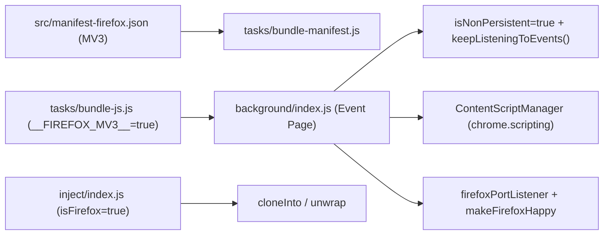

# Architecture & Technical Design

## 1. Overview & Invariants
Replaces `PLATFORM.FIREFOX_MV2` with `PLATFORM.FIREFOX_MV3` mapped to `'firefox'`, converting the Firefox target to Manifest V3 while preserving `PLATFORM.THUNDERBIRD` on Manifest V2.

**Key Invariants:**
- **Manifest invariant**: `build/release/firefox/manifest.json` has `manifest_version: 3`, `background.scripts: ["background/index.js"]`, `action`, `host_permissions: ["<all_urls>"]`, `strict_min_version: "128.0"`, and `match_about_blank: false` on all `content_scripts`. `thunderbird` retains `manifest_version: 2`, `background.page`, and `browser_action`.
- **Platform flag invariant**: `__FIREFOX_MV3__` is `true` for Firefox builds and `false` for Chrome/Thunderbird/API; `isFirefox` remains `true` for both Firefox MV3 and Thunderbird so Gecko Xray (`cloneInto`, `unwrap`) and messaging (`firefoxPortListener`, `makeFirefoxHappy`) continue working.
- **MV3 lifecycle invariant**: `isNonPersistent` is `true` on Firefox MV3 (`!__THUNDERBIRD__ && (__CHROMIUM_MV3__ || __FIREFOX_MV3__ || isSafari)`), enabling `keepListeningToEvents()`, `Extension.isFirstLoad`, `ContentScriptManager`, and `TabManager.registerDeclarativePrePaint`.

## 2. Domain Models, State & Interface Contracts
- **Build Platform (`tasks/platform.js`)**:
  - Remove `FIREFOX_MV2`; set `FIREFOX_MV3: 'firefox'`.
  - `tasks/build.js`: map `--firefox` and `--firefox-mv3` to `PLATFORM.FIREFOX_MV3`; remove the `FIREFOX_MV3` disable guard.
  - `tasks/bundle-js.js`: define `__FIREFOX_MV3__: platform === PLATFORM.FIREFOX_MV3`, keep `__FIREFOX_MV2__: false`, apply `chrome.browserAction.*` -> `chrome.action.*` replacements for `PLATFORM.FIREFOX_MV3` alongside `PLATFORM.CHROMIUM_MV3`, and bundle `inject/proxy.js` and `inject/color-scheme-watcher.js` for `PLATFORM.FIREFOX_MV3` if needed by `ContentScriptManager` / manifest.
  - `tasks/bundle-html.js`: emit `background/index.html` only for `PLATFORM.THUNDERBIRD`.
  - `tasks/bundle-manifest.js`: keep `action`, `options_ui`, `host_permissions`, `content_security_policy` for `PLATFORM.FIREFOX_MV3`; delete Chrome-only `minimum_chrome_version` on Firefox; omit `navigate-to` from Firefox `content_security_policy.extension_pages`.
- **Runtime Guards (`src/`)**:
  - `src/utils/platform.ts`: `isFirefox` includes `__FIREFOX_MV3__`; `isNonPersistent` includes `__FIREFOX_MV3__`.
  - `src/background/index.ts`, `src/background/extension.ts`, `src/background/content-script-manager.ts`, `src/background/tab-manager.ts`, `src/background/utils/extension-api.ts`: generalize MV3 checks (`__CHROMIUM_MV3__ || __FIREFOX_MV3__`) where `chrome.scripting` or event-page wakeup applies, while keeping Chromium-specific `documentId` / `proxy.js` rules scoped appropriately.
  - `src/inject/index.ts`, `src/inject/fallback.ts`, `src/ui/popup/theme/controls/export-theme.tsx`: update `__FIREFOX_MV2__` compile guards to `__FIREFOX_MV3__` (or `isFirefox` where appropriate).

## 3. Architecture Diagram & Data Flow

## 4. Boundary Rules & Budgets
- **Pure Core vs. I/O Shell**: Theme generation (`src/generators/`, `src/inject/dynamic-theme/modify-colors.ts`) has zero browser-API or MV2/MV3 coupling and is untouched. Platform/manifest/lifecycle changes are isolated to `tasks/`, `src/manifest-firefox.json`, `src/utils/platform.ts`, and `src/background/` I/O shells.
- **Concurrency, Latency & Resource Budgets**: Zero added runtime latency on page load; `chrome.scripting.registerContentScripts` preserves `NFR-FOUC-1` (zero white frames) and `NFR-FFMV3-1` (zero Thunderbird/API regression).

## 5. Testing Strategy
1. **BDD Scenarios**: Verify `REQ-FFMV3-1`..`REQ-FFMV3-4` and `REQ-FOUC-2` against built `firefox` and `thunderbird` manifests and unit suites.
2. **Unit Tests (>= 95% coverage)**: Update `tests/unit/jest.config.mjs` globals (`__FIREFOX_MV3__`), `tests/unit/utils/messaging.tests.ts`, `tests/unit/brand/brand.tests.ts`, and add `src/manifest-firefox.json` MV3/CSP assertions in `tests/unit/csp/csp.tests.ts`.
3. **Browser & Build Verification**: Update `tests/browser/jest.config.firefox.mjs` (`__FIREFOX_MV3__: true`, `__FIREFOX_MV2__: false`), run `npm test`, `npm run lint`, `npm run build`, and `npm run api` (plus `npm run test:firefox` in Firefox-capable environments).

## Review Gate
- [x] **Gate 2 Approval**: Architecture & design reviewed and approved by human before task breakdown.
