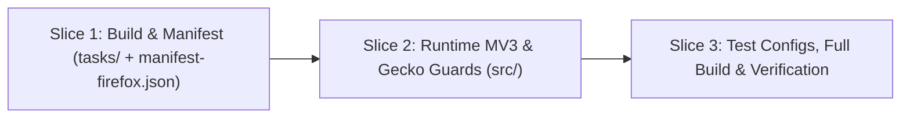

# Tasks

## 1. Dependency DAG

## 2. Streams & Worktrees
| Stream | Worktree Path | Branch | Prerequisite |
| :--- | :--- | :--- | :--- |
| `main-slice` | `.worktrees/migrate-firefox-mv3` | `feat/migrate-firefox-mv3` | Gate 3 Approval |

## 3. Slice 1: Firefox MV3 Manifest & Build Target

- [x] 3.0 Contract scaffolding: declare `__FIREFOX_MV3__` ambient global in `src/definitions.d.ts` / `tests/unit/jest.config.mjs` / `tests/inject/karma.conf.js` and fold `PLATFORM.FIREFOX_MV2` -> `PLATFORM.FIREFOX_MV3 = 'firefox'` in `tasks/platform.js` (verify: `npm run lint` passes on touched files)
- [x] 3.1 Red unit tests: add Firefox MV3 manifest assertions (`manifest_version === 3`, `background.scripts`, `action`, `host_permissions`, `strict_min_version === '128.0'`, `match_about_blank === false`, no `navigate-to` in CSP) in `tests/unit/csp/csp.tests.ts` and `tests/unit/utils/messaging.tests.ts` (verify: `npm test` fails on `src/manifest-firefox.json` MV2 fields) Evidence: `npx jest --config=tests/unit/jest.config.mjs tests/unit/csp/csp.tests.ts` failed with `Expected: 3, Received: 2`
- [x] 3.2 Green implementation: convert `src/manifest-firefox.json` to MV3 and update `tasks/build.js`, `tasks/cli.js`, `tasks/bundle-manifest.js`, `tasks/bundle-html.js`, `tasks/bundle-js.js`, `package.json`, `tasks/dependencies.js` (verify: `npm test` and `npm run build -- --firefox --thunderbird --release` pass; `build/release/firefox/manifest.json` has `manifest_version: 3` and `thunderbird` has `manifest_version: 2`) Evidence: `npm test` 27/27 suites (164/164 tests) passed

## 4. Slice 2: Runtime MV3 Lifecycle & Gecko Compatibility

- [x] 4.0 Contract scaffolding: update `src/utils/platform.ts` (`isFirefox`, `isNonPersistent`) and compile-time flag declarations (`__FIREFOX_MV3__`) across `src/` (verify: `npm run lint` passes)
- [x] 4.1 Red unit tests: add/update tests verifying `isNonPersistent` and MV3 `ContentScriptManager` / `TabManager.registerDeclarativePrePaint` gating for Firefox MV3 (verify: `npm test` fails for expected reason before implementation) Evidence: `npx jest --config=tests/unit/jest.config.mjs tests/unit/background/tab-manager-fouc.tests.ts` failed on missing `__FIREFOX_MV3__`
- [x] 4.2 Green implementation: update `src/background/index.ts`, `src/background/extension.ts`, `src/background/content-script-manager.ts`, `src/background/tab-manager.ts`, `src/background/utils/extension-api.ts`, `src/inject/index.ts`, `src/inject/fallback.ts`, `src/ui/popup/theme/controls/export-theme.tsx` for Firefox MV3 while keeping `isFirefox` (`cloneInto`, `unwrap`, `firefoxPortListener`) and `thunderbird` MV2 intact (verify: `npm test`, `npm run lint`, and `npm run api` pass) Evidence: `npm test` 27/27 (165/165), `npm run lint` 0 errors, `npm run api` passed

## 5. Slice 3: Test Configs, Full Build & Verification

- [x] 5.1 Update `tests/browser/jest.config.firefox.mjs` (`__FIREFOX_MV3__: true`, `__FIREFOX_MV2__: false`) and `tests/unit/brand/brand.tests.ts` if needed (verify: `npm test` passes) Evidence: `npm test` 27/27 (165/165) passed
- [x] 5.2 Run full verification gates: `npm test`, `npm run lint`, `npm run build`, `npm run api` (and `npm run test:firefox` if Firefox browser binary is available) (verify: all gates pass with 0 errors) Evidence: `npm test` 27/27 (165/165), `npm run lint` 0 errors, `npm run api` passed, `npm run build` passed (`firefox` MV3, `thunderbird` MV2)

## 6. Integration & Rebase Plan
- [ ] 6.1 Human Comprehension Verification: reviewer can explain all generated logic line-by-line
- [ ] 6.2 Merge/rebase on `main`, re-verify rails, and run `openspec archive migrate-firefox-mv3`

## Review Gate
- [x] **Gate 3 Approval**: Tasks breakdown approved by human before writing test code.
