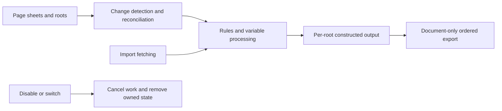

# Architecture & Technical Design

## 1. Overview & Invariants

Keep the existing Lean injector and shared color transforms. Reproduce each suspected defect through observable browser behavior before fixing it. Dynamic remains the default and its existing behavior must remain covered. Lean retains constructed-sheet output, no image-analysis canvas, and support for accessible open shadow roots.

## 2. Domain Models, State & Interface Contracts

- Track page-authored adopted sheets per `(root, source sheet)` rather than globally per sheet. Reconcile current source membership and changes with output membership, ignoring owned sheets; remove generated output when a source or root disappears.
- Detect real CSSOM updates in supported browsers, including same-count edits. Choose and test an observer/proxy or bounded fallback that cooperates with existing Dynamic lifecycle and does not assume test-only events.
- Resolve accessible imports with their original URL bases, order and media/supports/layer conditions; guard cycles, failures and cancellation. Reuse existing safe loading behavior where feasible.
- Scope asynchronous callbacks and mutations to an active generation, and clean all inline override types from every tracked accessible root on teardown. Preserve page-owned state.
- Serialize owned document sheets in actual adopted cascade order. Never flatten shadow-root output into the document export; document this limit.

## 3. Architecture Diagram & Data Flow

## 4. Boundary Rules & Budgets

- **Pure Core vs. I/O Shell**: Keep rule transformation and ordering decisions independently testable; the injector owns DOM, browser APIs and network operations.
- **Concurrency, Latency & Resource Budgets**: Zero Lean sync style elements and image-analysis canvases. Coalesce mutation bursts and retain a bounded shared cache. Import traversal must terminate on cycles and cancellation. Measure CPU, memory and startup on repeatable workloads; no unsupported numeric speedup is promised.

## 5. Testing Strategy

1. **BDD Scenarios**: Use real browser CSSOM operations, computed styles and cleanup assertions for every delta scenario. Run Lean and Dynamic regression cases on supported Chrome and Firefox environments, recording any unavailable environment.
2. **Unit Tests (>= 95% line and branch coverage)**: Target changed pure logic and lifecycle boundaries; report denominators and exclusions, and identify infrastructure blockers rather than claiming an unmeasured pass.
3. **Mutation Testing (>= 95% kill)**: Target changed pure logic with meaningful mutants; report survivors and exclusions or the precise blocker if tooling cannot run.
4. Demonstrate each confirmed regression fails before its fix and passes afterward, then run all six project gates and compare performance workloads. Reconcile the earlier change's checklist only against evidence.

## Review Gate
- [x] **Gate 2 Approval**: Architecture & design reviewed and approved by human before task breakdown.
