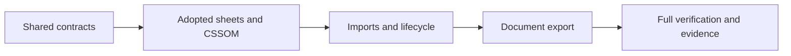

# Tasks

## 1. Dependency DAG

## 2. Streams & Worktrees

| Stream | Worktree Path | Branch | Prerequisite |
| :--- | :--- | :--- | :--- |
| `fidelity` | `.worktrees/verify-lean-dynamic-fidelity-fidelity` | `codex/verify-lean-dynamic-fidelity` | Gate 3 approval; sequential slices share injector state |

## 3. Shared Contracts

- [ ] 3.0 Define and commit minimal reconciliation, cancellation and export contracts without changing behavior; verify lint and contract compilation.

## 4. Adopted Sheets and CSSOM

- [ ] 4.0 Red: add browser tests for one sheet shared across roots, additions/removals/replacements and real same-count CSSOM edits; capture expected failures.
- [ ] 4.1 Green: reconcile each root and detect actual sheet changes without processing owned sheets; verify red tests pass and page-owned sheets survive teardown.
- [ ] 4.2 Measure changed pure logic line/branch coverage and mutation kill against 95% targets; verify reports and address meaningful gaps.

## 5. Imports and Lifecycle

- [ ] 5.0 Red: test nested conditional cross-origin imports, failure/cycles, inline cleanup across all override types and shadow roots, and switching during pending loads; capture expected failures.
- [ ] 5.1 Green: resolve imports with conditions and URL bases, cancel stale work and clean owned state; verify red tests and engine-switch regressions pass.
- [ ] 5.2 Measure changed pure logic line/branch coverage and mutation kill against 95% targets; verify reports and address meaningful gaps.

## 6. Document Export

- [ ] 6.0 Red: assert exported document rules preserve live cascade and omit shadow rules; capture expected failures.
- [ ] 6.1 Green: serialize document-owned sheets in live order and document the shadow-root limitation; verify exported CSS behavior and live shadow styling.
- [ ] 6.2 Measure changed pure logic line/branch coverage and mutation kill against 95% targets; verify reports and address meaningful gaps.

## 7. Integration & Rebase Plan

- [ ] 7.0 Verify registration, palette and sliders, fixes, ignored selectors, no Lean sync style elements or image-analysis canvas, and Dynamic shared-helper regressions in representative Chrome and Firefox tests; record unavailable environments.
- [ ] 7.1 Run `npm test`, `npm run test:browser`, `npm run test:inject`, `npm run lint`, `npm run build`, and `npm run api`; record outcomes and any environment blockers.
- [ ] 7.2 Measure startup, CPU and memory for Lean and Dynamic on repeatable representative workloads; report methodology, results and limitations without assuming improvement.
- [ ] 7.3 Reconcile the earlier change's tasks and conflicting requirement identifiers against actual evidence; verify no unsupported completion claims or accidental spec changes.
- [ ] 7.4 Human comprehension verification: review the implementation and red-green evidence; verify the reviewer can explain the changed logic.
- [ ] 7.5 Integrate and rebase the stream, rerun affected checks and strict OpenSpec validation; verify the final state before a separate archive decision.

## Review Gate
- [x] **Gate 3 Approval**: Tasks breakdown approved by human before writing test code.
