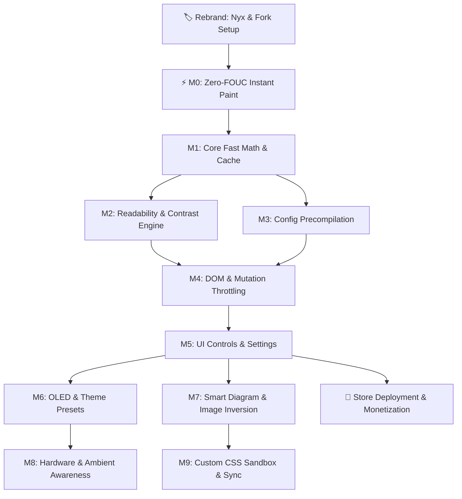

# Nyx Engineering Roadmap: Performance, Readability & Brand Launch

> **Brand**: **Nyx** (*Greek goddess of night*)  
> **Tagline**: *Instant Dark Mode for the Web. Zero White Flash.*  
> **Core Value**: Next-gen dark mode engine with zero-FOUC instant paint, automated WCAG contrast, and OLED support.

---

## 🏷️ Brand Identity & Fork Compliance (Nyx)

- [ ] **B.1. Metadata & Manifest Rebranding**
  - **Files**: `tasks/bundle-manifest.js`, `src/manifest.json`, `package.json`
  - **Action**: Update extension name to **Nyx**, short description, homepage URL, and repository references.
- [ ] **B.2. MIT License Compliance & Attribution**
  - **File**: `LICENSE`
  - **Action**: Preserve original copyright notice (`Copyright (c) 2026 Dark Reader Ltd.`) and add Nyx contributors notice.
- [ ] **B.3. Icon & Visual Assets**
  - **Files**: `src/ui/assets/icons/`
  - **Action**: Generate sleek minimalist logo for Nyx (crescent/veil motif) across 16x16, 32x32, 48x48, 128x128.
- [ ] **B.4. Custom Donation / Sponsor Link**
  - **File**: `src/utils/links.ts`
  - **Action**: Route `DONATE_URL` to Nyx sponsor/donation page (Ko-fi, GitHub Sponsors, Stripe).

---

## ⚡ Flagship Priority #1: Zero-FOUC (Instant Dark Paint)
- **Problem**: Opening new tabs or navigating websites flashes bright white for several frames before the content script loads, parses CSS, and inverts colors. This is the #1 complaint across all dark mode tools.
- **Root Cause**: Content script injection occurs asynchronously after the initial paint lifecycle begins; MV3 service worker wakeup latency further delays CSS delivery.
- **Fix**: Inject synchronous declarative root styles via `chrome.scripting.insertCSS` with `runAt: 'document_start'` and `cssOrigin: 'USER'` (or early blocking stylesheet in `src/inject/dynamic-theme/injection.ts`), locking `html, body { background: #181a1b !important; color: #e8e6e3 !important; }` before the first paint cycle.

---

## Key Optimization Opportunities

### 1. Precompile Configs at Build Time
- **Problem**: `src/config/dynamic-theme-fixes.config` is ~820KB raw text. Parsed at startup via string splits and line-by-line regex in `src/generators/utils/parse.ts`.
- **Fix**: Compile into binary trie or compact JSON trie at build time (`tasks/build.js`). Cuts startup parse time and memory footprint in service worker.

### 2. Fix Cache Eviction (FIFO $\to$ LRU)
- **Problem**: `cachedFactory` in `src/utils/cache.ts` uses FIFO (`Map.keys().next()`). Hot keys get evicted if map exceeds size, causing recalculation spikes on long sessions.
- **Fix**: Re-insert key on hit (`cache.delete(key); cache.set(key, val)`) for true LRU.

### 3. Fast-Path CSS Color Parsing
- **Problem**: `src/utils/color.ts` relies heavily on regex matching for `#hex`, `rgb(...)`, `rgba(...)`.
- **Fix**: Direct character-code inspection for hex and standard `rgb()` strings. Skip regex on hot execution paths.

### 4. Inline Style & Mutation Batching
- **Problem**: `src/inject/dynamic-theme/inline-style.ts` monitors DOM mutations. High-churn SPAs trigger layout thrashing and repeated style calculations.
- **Fix**: Enlarge microtask batching window and debounce style modification on mutating nodes.

### 5. Config Pruning
- **Problem**: 800+ KB config contains dead domains and outdated selectors.
- **Fix**: Run automated ping/cleanup task (`tasks/ping.js`) to prune dead rules and reduce selector engine workload.

---

## Implementation Milestones

### Milestone 0: Zero-FOUC Instant Dark Paint (Flagship UX)
*Goal: 100% eliminate white screen flashes during tab creation and page navigation.*

- [ ] **0.1. Declarative User Origin Root Stylesheet**
  - **Path**: `src/inject/dynamic-theme/injection.ts`
  - **Action**: Enforce root baseline dark canvas (`html, body { background: #181a1b !important; }`) synchronously before HTML parsing starts.
- [ ] **0.2. Service Worker Pre-Paint CSS Registration (MV3)**
  - **Path**: `src/background/tab-manager.ts`
  - **Action**: Pre-register dynamic content scripts/styles using `chrome.scripting.registerContentScripts` so styles apply before content script handshake completes.

---

### Milestone 1: Core Performance Quick Wins
*Goal: Remove micro-bottlenecks in hot paths before layering new color logic.*

- [ ] **1.1. Convert `cachedFactory` to True LRU**
  - **Path**: `src/utils/cache.ts`
  - **Action**: Change FIFO eviction to delete-and-reinsert on cache hits. Prevent cache churn on long browsing sessions.
- [ ] **1.2. Fast-Path CSS Color Parser**
  - **Path**: `src/utils/color.ts`
  - **Action**: Bypass regex for standard 3/6-digit hex (`#fff`, `#ffffff`) and integer `rgb(r, g, b)`. Use char code inspection.
- [ ] **1.3. Unit Test & Benchmark Baseline**
  - **Action**: Establish benchmark for `parseColor` and `modifyColorWithCache` under heavy load.

---

### Milestone 2: Automated Readability & Contrast Engine
*Goal: Ensure WCAG AA (4.5:1) text contrast dynamically without layout thrashing.*

- [ ] **2.1. Relative Luminance & Contrast Math Utilities**
  - **Path**: `src/utils/color.ts`
  - **Action**: Add sRGB relative luminance calculation ($L = 0.2126R + 0.7152G + 0.0722B$) and contrast ratio formula $\frac{L_1 + 0.05}{L_2 + 0.05}$.
- [ ] **2.2. Pole-Relative Minimum Contrast Floor**
  - **Path**: `src/inject/dynamic-theme/modify-colors.ts`
  - **Action**: In `modifyFgHSL()`, evaluate contrast against background pole. Dynamically scale text lightness $L$ until contrast $\ge 4.5:1$ is met.
- [ ] **2.3. Paired CSS Rule Contrast Enforcement**
  - **Path**: `src/inject/dynamic-theme/modify-css.ts`
  - **Action**: When a single CSS declaration defines both `color` and `background-color`, inspect both generated colors. If contrast $< 4.5:1$, shift text color towards high-contrast pole.

---

### Milestone 3: Config Architecture & Build Precompilation
*Goal: Eliminate 820KB runtime regex parsing during service worker / background startup.*

- [ ] **3.1. Build-Time Serialization for Site Fixes**
  - **Paths**: `tasks/bundle-manifest.js`, `tasks/build.js`, `src/generators/utils/parse.ts`
  - **Action**: Compile `src/config/dynamic-theme-fixes.config` into indexed JSON or flat trie at build time.
- [ ] **3.2. Background Config Manager Fast-Load**
  - **Path**: `src/background/config-manager.ts`
  - **Action**: Load pre-indexed structures directly. Bypass `indexSitesFixesConfig()` regex splitting on extension boot.
- [ ] **3.3. Config Pruning via Automated Ping**
  - **Path**: `tasks/ping.js`
  - **Action**: Run prune run on dead domains to reduce selector payload.

---

### Milestone 4: DOM Mutation & Microtask Throttling
*Goal: Prevent reflow spikes on SPAs and infinite scroll pages.*

- [ ] **4.1. Inline Style Batching**
  - **Path**: `src/inject/dynamic-theme/inline-style.ts`
  - **Action**: Batch DOM mutation records into single microtask queue before triggering inline style recoloring.
- [ ] **4.2. Adopted Style Manager Optimization**
  - **Path**: `src/inject/dynamic-theme/adopted-style-manger.ts`
  - **Action**: Cache converted `CSSStyleSheet` objects to eliminate redundant style sheet construction in Shadow DOM roots.

---

### Milestone 5: UI Integration & User Control
*Goal: Expose readability controls cleanly without UI clutter.*

- [ ] **5.1. Theme Definition Extension**
  - **Path**: `src/definitions.d.ts`, `src/defaults.ts`
  - **Action**: Add `autoContrast: boolean` (or `minContrastRatio: number`) property to theme schema.
- [ ] **5.2. Settings Toggle in Popup**
  - **Path**: `src/ui/popup/components/filter-settings/`
  - **Action**: Add toggle for "Enhanced Readability / Auto-Contrast".

---

### Milestone 6: OLED & Theme Presets
*Goal: Support true pitch black and popular developer color themes.*

- [ ] **6.1. OLED Pitch Black Mode**
  - **Path**: `src/defaults.ts`, `src/inject/dynamic-theme/modify-colors.ts`
  - **Action**: Add `oled: boolean` setting clamping `darkSchemeBackgroundColor` to `#000000` with black point curve adjustment.
- [ ] **6.2. Built-in Colorway Presets**
  - **Path**: `src/config/color-schemes.drconf`, `src/ui/popup/`
  - **Action**: Add 1-click presets: Catppuccin Mocha, Nord, Dracula, Gruvbox, Tokyo Night.

---

### Milestone 7: Smart Diagram & Image Inversion
*Goal: Automatically invert white-background diagrams, charts, and formulas without altering photos.*

- [ ] **7.1. Luminance & Entropy Sampler for Images**
  - **Path**: `src/inject/dynamic-theme/image.ts`
  - **Action**: Sample edge/background pixels in SVGs and small PNG charts via OffscreenCanvas; invert if background is bright white and entropy is low (diagrams vs photos).
- [ ] **7.2. Math & Formula Detection**
  - **Path**: `src/inject/dynamic-theme/selectors.ts`
  - **Action**: Automatic inversion rules for LaTeX / MathJax / KaTeX image renderings.

---

### Milestone 8: Hardware & Ambient Awareness
*Goal: Adapt dynamically to environment and power constraints.*

- [ ] **8.1. Battery & Ambient Light Reactive Mode**
  - **Path**: `src/background/`
  - **Action**: Listen to Battery Status API (`navigator.getBattery()`) and Ambient Light Sensor to automatically switch to OLED mode or lower brightness in dark rooms.

---

### Milestone 9: Custom CSS Sandbox & Sync
*Goal: Allow instant per-site custom rules without file modifications.*

- [ ] **9.1. Per-Site Custom CSS Editor in Popup**
  - **Path**: `src/ui/popup/`, `src/background/user-storage.ts`
  - **Action**: Add direct code editor tab to inject raw CSS per domain.
- [ ] **9.2. Profile Import / Export**
  - **Path**: `src/background/user-storage.ts`
  - **Action**: One-click JSON / Gist export and import for site fixes and custom rules across machines.
